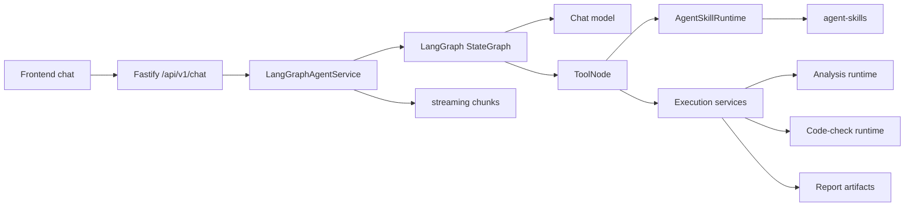

# Agent Architecture

This document describes the current StructureClaw 1.0.0 agent runtime. It is a code-aligned reference for contributors, not a planning document.

### Model contract and responsibility boundaries

Partial node, member and load records are validated against the accepted record with the same ID, after explicit removals. This preserves coordinates, connections and units without making the model repeat every field. Unrelated records and combination factors remain intact; the legacy skill-state draft is a view of the merged draft. Only diagnostics for withdrawn fields are cleared; other conflicts and original evidence remain.

A whole-material-group missing diagnostic uses the same material projection as template construction: a supported declared grade or complete explicit material records can satisfy it. Unknown grades, incomplete explicit records, specific object/field requirements and conflicting evidence remain unresolved. The projection is read-only and does not create a second writable material source.

Chat and the runtime extraction entry point use the same LLM extractor and update contract. Omitted fields are unchanged; record arrays merge by stable ID. An explicit withdrawal is expressed as `clearDraftFields: ['sectionRecords["S1"].standard_steel_name']`, then the new `engineeringDraft` fields are merged. Clear operations validate all targets on a copy before committing. Record IDs and raw evidence cannot be cleared as ordinary fields. The tool returns the applied clears and the resulting draft. Shape changes no longer silently erase supplied properties; replacing a definition requires an explicit clear of the old definition. No natural-language deletion regex is used.

Section `name` is a label; designations never select catalog data (there is no section catalogue). A designation with four dimensions (`HN300×150×6.5×9`, `H300x150x6.5x9`) is read as explicit sharp-corner H×B×tw×tf geometry, stated in the report; a designation without plate thicknesses (`HN300×150`) produces one clarification for tw/tf or complete properties. `standard_steel_name` is only a native PKPM/YJK selector and is dropped when a designation is parsed into geometry. Geometry/property conflicts still fail formal validation. Self-weight may use the sole unclassified (`other`) analysis case without renaming it a dead case; its recorded resolution is `sole-unclassified-case`. Multiple candidate cases still require a target.

The LLM interprets intent, identifies missing information, and proposes model fields. Deterministic code validates units, physical consistency, evidence, edits and run identity, then executes the selected solver. Reference material/section tables and geometric calculations remain deterministic; they must not contain example-specific answers.

`StructureModelV2` in Python is the authoritative physical schema. `backend/scripts/export-model-contract.py` exports the checked-in JSON schema used by the extraction and generic-building prompts. The draft adds only convenience fields, with physical records and `coordinateSystem`/`analysisControl` referring to this schema. Coordinate dimension must come from the request; coplanar coordinates alone do not establish a 2D analysis. Legacy scalar locations are converted at the boundary. Templates no longer invent an all-cases, factor-one `ULS` combination: combinations require declared factors.

Draft issues distinguish `kind: missing` from `kind: confirmation`. Missing values are re-evaluated against current typed data; confirmation needs an explicit new field value, and source conflicts remain unresolved. Runtime-bound paths follow stable IDs through record reordering. `invalidDraftFields` is a compatibility view rather than a separately maintained checklist. Old ambiguous issues with an existing value remain conservative. No builder, including explicit imports, may bypass unresolved physical input.

The default builder remains `auto`. Choosing `llm` skips template-specific counts and recipes while retaining formal model validation; partial topology goes through LLM completion. A full imported model still uses the preserving import path, recorded as `builder: explicit` with the requested policy; `auto` also directly assembles complete explicit topology. Actual LLM generation receives the model schema, and any correction receives the previous candidate and exact validation error. A builder's `missing_fields` response requests clarification without a failed tool call or recovery-budget charge. Invalid candidate correction still uses the shared recovery budget; transport failures are not disguised as semantic corrections.

Design inputs (design strengths, stability factors, limits, effective lengths, service keys) are not draft diagnostics: extraction drops design-field issues, so they never block or prompt the analysis workflow. They are stored only when the user supplies them. An explicitly requested code check determines the code-determined ones itself and records each value with its source in `designValues` (check output, delivery notice and report): GB 50017-2017 f, fv, fy from the grade and governing plate thickness (Table 4.4.1, flange thickness for H sections); section properties from geometry; β1 per 6.1.5 (1.1, no local compressive stress is modelled); εk from the grade's nominal yield; width-thickness limits from Table 3.5.1 class S4 (needed by 6.1.1 for the full section modulus with γx = 1.0); a slenderness limit only for columns (Table 7.4.6). GB 50010 fc, ft and rebar fy come from the concrete and rebar grades. The tables live in `skill-shared/python/structure_protocol/design_code_tables.py`. Values in the model override them. Engineering-judgment inputs (lateral bracing/effective length → φb, l0; deflection-limit category → L/n; service case) are never defaulted and are listed as missing. A concrete frame's rebar grade is such a check input: elastic analysis never requires it.

Force-only requests (internal forces, reactions) need no material or section. When a forces/reactions-only static request (`requestScope.design=false`, no self-weight, no commercial engine) declares no material and/or no section, the template builder uses labelled unit placeholder stiffness (`engineering/stiffness-placeholder.ts`) and records `metadata.stiffnessPlaceholder` with the degree of static indeterminacy. A determinate structure's forces do not depend on stiffness; an indeterminate one is solved with every member sharing one EI, and `build_model`/`run_analysis` return `equalStiffnessAssumed=true` so the answer states that assumption. Sections declared for some member roles but not others are still asked for. Displacements of a placeholder run are never presented: the run_analysis summary and the frontend analysis payload drop them, `query_results` rejects displacement queries and `generate_report` refuses the run (`STIFFNESS_PLACEHOLDER_RUN`); the saved run keeps solver data for force recovery. A later displacement, period or design request no longer satisfies the force-only condition, so the draft asks for the real material and section; `run_code_check` refuses a placeholder model with `STIFFNESS_PLACEHOLDER_MODEL`, and the native design review reports it unavailable with that reason. When `edit_model` gives every member a real material and section (updating the placeholder records' stiffness or assigning new records), the placeholder label, the unused placeholder records and `metadata.stiffnessPlaceholder` are removed; a partial edit keeps the model a placeholder model. There is no separate equilibrium path: runs saved by the retired shortcut (engine `builtin-equilibrium`) load read-only, and a query for a field they never stored returns `RESULT_FIELD_UNAVAILABLE`; a saved `requestScope.method` is accepted and ignored.

## 1. Runtime Shape

StructureClaw uses a capability-driven agent:

```text
Frontend chat UI
  -> Fastify chat API
  -> LangGraph ReAct agent
  -> registered tools
  -> skill runtime and backend execution services
  -> streamed assistant presentation
```

The agent is not mode-driven. A normal conversation can stay on the base LLM path, while engineering requests can activate skills and tools for draft extraction, validation, analysis, code checking, and reporting.



## 2. Public Entry Points

Chat routes live in [backend/src/api/chat.ts](../backend/src/api/chat.ts) and are mounted under `/api/v1/chat`:

- `POST /api/v1/chat/message`: synchronous chat execution.
- `POST /api/v1/chat/stream`: server-sent event streaming (handled by `runSseTurn` in [backend/src/api/chat-sse.ts](../backend/src/api/chat-sse.ts)).
- `POST /api/v1/chat/stream/resume`: resume a paused interaction.
- Conversation create, list, snapshot, session and message routes are in the same module.

Agent capability, run, review and SkillHub routes live in [backend/src/api/agent.ts](../backend/src/api/agent.ts) under `/api/v1/agent`:

- `GET /api/v1/agent/skills`, `GET /api/v1/agent/tools`, `GET /api/v1/agent/capability-matrix`
- `GET /api/v1/agent/run-profiles`: ablation profile catalogue (see [ablation.md](./ablation.md)).
- `POST /api/v1/agent/run` (agent orchestration entry) and `POST /api/v1/agent/resume` (resume a saved clarification).
- `GET` / `POST /api/v1/agent/input-review/:conversationId[/tools]` and `GET` / `POST /api/v1/agent/result-review/:conversationId[/tools]`: input-evidence and result-review panels.
- `GET /api/v1/agent/skillhub/search`, `GET /api/v1/agent/skillhub/installed`, and `POST /api/v1/agent/skillhub/{install,enable,disable,uninstall}`.

Backend-hosted analysis runtime endpoints live in [backend/src/api/analysis-runtime.ts](../backend/src/api/analysis-runtime.ts). They are registered without the `/api/v1` prefix:

- `POST /validate`, `POST /convert`, `POST /analyze`, `POST /code-check`
- `GET /runs/:id`, `GET /analysis-requests/:id`, `POST /analysis-requests/:id/{cancel,recover}`
- `GET /schema/structure-model-v1`, `GET /schema/structure-model-v2`, `GET /schema/converters`
- `GET /engines`, `GET /engines/:id`, `POST /engines/:id/check`

## 3. Layers And Core Runtime Files

The backend is organised into seven layers, L0 (shared) to L6 (delivery). [backend/.dependency-cruiser.cjs](../backend/.dependency-cruiser.cjs) enforces them; run `npm run check:deps --prefix backend` after changing imports across modules. Lower layers never import higher ones, and file-level import cycles are errors.

| Layer | Location | Contents |
|---|---|---|
| L0 shared | `backend/src/shared/` (`locale.ts`, `types/agent.ts`), `backend/src/types/` | Cross-layer types and locale resolution. |
| L1 kernel | `backend/src/runtime/`, `backend/src/config/`, `backend/src/utils/`, `backend/src/generated/` | Run policy and run context, tool-call limits, ablation profiles, settings loading, Prisma client, logging and helpers. |
| L2 domain | `backend/src/engineering/`, `backend/src/skill-shared/`, `backend/src/agent-skills/` | Structure-model contracts, section geometry, solver and code-check logic, and skill implementations. |
| L3 agent-core | `backend/src/agent-runtime/` | Skill loader and registry, `AgentSkillRuntime`, and the draft boundary (`draft/`). |
| L4 services | `backend/src/services/` | Capability metadata, analysis and code-check execution clients, chat persistence, conversation and memory services. |
| L5 agent-host | `backend/src/agent-langgraph/` | LangGraph graph, tools, tool context, final-answer delivery, session snapshots, attachments. |
| L6 delivery | `backend/src/api/`, `backend/src/index.ts` | Fastify routes and SSE transport. |

The dependency rules have two deliberate exceptions:

- `runtime/policy-settings.ts` is a re-export shim for `agent-langgraph/policy-resolver.ts`, kept because `integrations/openclaw/worker.mjs` imports the old path.
- Structure-type and section skill handlers may import a fixed list of agent-runtime skill-handler SDK modules (`SKILL_HANDLER_SDK`). No other L2 module may import L3.

| Area | File | Responsibility |
|---|---|---|
| Agent service | [backend/src/agent-langgraph/agent-service.ts](../backend/src/agent-langgraph/agent-service.ts) | Creates the singleton `LangGraphAgentService`; owns streaming, synchronous, run and resume entry points, conversation creation, checkpointer setup and execution-client injection. Attachment and ground-motion handling (`attachments/`), initial-message construction, session snapshots (`session/snapshot.ts`), and the per-turn tool access policy and recursion limit (`turn-config.ts`) are split out of it. |
| Graph | [backend/src/agent-langgraph/graph.ts](../backend/src/agent-langgraph/graph.ts) | Builds the LangGraph ReAct loop (`START -> agent -> tools -> agent -> END`) and the per-node tool context. |
| Run policy | [backend/src/runtime/run-policy.ts](../backend/src/runtime/run-policy.ts), [run-policy-schema.ts](../backend/src/runtime/run-policy-schema.ts), [run-context.ts](../backend/src/runtime/run-context.ts) | `EffectiveRunPolicy` resolved once per turn and frozen by `createRunContext`; the Zod schema for request and settings input; run usage. |
| Policy resolution | [backend/src/agent-langgraph/policy-resolver.ts](../backend/src/agent-langgraph/policy-resolver.ts) | Builds the layers for `resolveRunPolicy` (`runtime/run-policy.ts`) from settings, the `SCLAW_RUN_PROFILE` value read in `config/index.ts`, the skill catalogue and the request. |
| Tool context | [backend/src/agent-langgraph/tool-context.ts](../backend/src/agent-langgraph/tool-context.ts) | `deriveToolContext` turns the policy and checkpointed state into a frozen `ToolContext` (active tool IDs, skill scope, tool-call budget, file allow-list). Tools read skill scope and file allow-list only from it; direct tool hosts (scripts, tests) pass a `toolContext` on `configurable`. |
| Ablation profiles | [backend/src/runtime/ablation-profiles.ts](../backend/src/runtime/ablation-profiles.ts) | Pre-registered profiles (`ABLATION_PROFILES_VERSION`), their policy presets and capability groups. See [ablation.md](./ablation.md). |
| Limits | [backend/src/runtime/limits.ts](../backend/src/runtime/limits.ts) | `DEFAULT_MAX_TOOL_CALLS_PER_TURN` (200) and the upper bound for the user-configured setting. |
| State | [backend/src/agent-langgraph/state.ts](../backend/src/agent-langgraph/state.ts) | Graph state channels: messages, locale, selected skills, draft state, artifacts and run policy. |
| Prompt | [backend/src/agent-langgraph/system-prompt.ts](../backend/src/agent-langgraph/system-prompt.ts) | Builds bilingual system prompts from selected skill manifests, current state and policy. |
| Tool barrel | [backend/src/agent-langgraph/tools.ts](../backend/src/agent-langgraph/tools.ts) | Re-exports the engineering tool factories and helpers from `tools/`. |
| Engineering tools | [backend/src/agent-langgraph/tools/](../backend/src/agent-langgraph/tools/) | One module per workflow tool (detect, extract, build, validate, run analysis, code check, report, clarification, session config), plus shared helpers (`shared.ts`, `draft-helpers.ts`, `analysis-resolution.ts`, `input-message.ts`) and the `compaction/` and `seismic-workflow/` subfolders. Model-editing tools (`review_input`, `query_model`, `edit_model`, `undo_model`, `query_results`) are in `model-tools.ts`. |
| Tool registry | [backend/src/agent-langgraph/tool-registry.ts](../backend/src/agent-langgraph/tool-registry.ts) | Declares built-in tools (ID, category, risk, localized metadata, factory) and builds the tool set. Tools defined in sibling modules (`model-tools.ts`, `workspace-tools.ts`, `file-tools.ts`, `shell-tool.ts`, `memory-tool.ts`, `calc-tool.ts`) are registered here too. |
| Tool policy | [backend/src/agent-langgraph/tool-policy.ts](../backend/src/agent-langgraph/tool-policy.ts) | Resolves enabled and disabled tool IDs; blocks shell tools unless the shell gate is enabled. |
| User tools | [backend/src/agent-langgraph/user-tool-loader.ts](../backend/src/agent-langgraph/user-tool-loader.ts) | Loads workspace tool definitions and appends them when the graph is built. |
| Final answer | [backend/src/agent-langgraph/delivery/final-answer.ts](../backend/src/agent-langgraph/delivery/final-answer.ts) | `applyFinalAnswerPolicy` replaces an empty final model response with a bilingual fallback. |
| Draft boundary | [backend/src/agent-runtime/draft/boundary.ts](../backend/src/agent-runtime/draft/boundary.ts) | The single draft boundary: `ingestDraft` merges an extraction patch (including `clearDraftFields`) into the existing draft; `projectDraftState` derives the state view. Helpers are in `draft/normalize.ts`, `draft/project-patch.ts` and `draft/legacy-fields.ts`. |
| Skill runtime | [backend/src/agent-runtime/index.ts](../backend/src/agent-runtime/index.ts) | `AgentSkillRuntime`: manifest listing, structural-type detection, model building, and analysis, code-check, validation and report skill execution. |
| Skill loader | [backend/src/agent-runtime/loader.ts](../backend/src/agent-runtime/loader.ts) | Discovers skill directories, loads stage markdown, and imports optional handlers. |
| Skill registry | [backend/src/agent-runtime/registry.ts](../backend/src/agent-runtime/registry.ts) | Resolves skills and plugins by ID, structure type and domain. |
| Analysis catalog | [backend/src/providers/analysis-catalog.ts](../backend/src/providers/analysis-catalog.ts) | Single engine catalog for builtin analysis skills (IDs, engine IDs, analysis types), derived from `providers/catalog.yaml`. It feeds the compatible `run_analysis.analysisSkillId` provider enum. |
| Capability API | [backend/src/services/agent-capability.ts](../backend/src/services/agent-capability.ts) | Builds frontend-facing capability metadata from skills, tools and engine availability. |
| Execution clients | [analysis-execution.ts](../backend/src/services/analysis-execution.ts), [code-check-execution.ts](../backend/src/services/code-check-execution.ts), [structure-protocol-execution.ts](../backend/src/services/structure-protocol-execution.ts) | Local clients used by the agent tool layer, plus structure validation and conversion helpers. |
| Chat persistence | [backend/src/services/chat-persistence.ts](../backend/src/services/chat-persistence.ts) | Persists assistant messages, debug details, latest results and session state for the chat routes. |

## 4. ReAct Loop

The graph is intentionally small:

1. `agent` node builds the bilingual system prompt, derives the node's `ToolContext` from the frozen run policy and checkpointed state, binds the active tools, invokes the chat model, and stops the turn with a warning once the tool-call budget is reached. The budget is `budgets.maxToolCallsPerTurn` in the effective run policy. It comes from `agent.runPolicy.budgets.maxToolCallsPerTurn` in settings (default 200). Requests above the server ceiling of 200 fail visibly; the old `agent.maxToolCallsPerTurn` key is read once as a migration.
2. `shouldContinue` checks whether the model returned tool calls.
3. `tools` node builds a fresh config for the node (`{ ...config, configurable: { ..., agentState, toolContext } }`), runs the calls sequentially inside the turn's run context, and writes artifacts back into graph state. Policy reaches tools through `toolContext` and `runContext`; the shared `configurable` is not mutated with policy fields.
4. Control returns to `agent` until no tool calls remain.

The `agent` node still writes the current state snapshot into `config.configurable.agentState` so the tools node can read state channels; this is the one remaining in-place write to `configurable`.

The compiled graph is cached for the process lifetime and can be rebuilt through `LangGraphAgentService.resetGraph()` after skill or tool changes.

### Guard layer

The LLM decides what to call and when to stop. A generic guard layer only handles unreasonable scheduling or output; it matches no user text and is inert on the normal path. Each intervention is a `kind: "guard"` run event (`guard`, `action`) and is counted in `usage.guards`.

| Guard | Threshold | Where |
|---|---|---|
| Repeated identical failure: the same tool with semantically identical arguments (key order, blanks ignored) failed with the same error code | 2 failures; the 3rd identical call is not executed and returns `REPEATED_FAILED_CALL` with the earlier error and what to change | `guards/tool-guards.ts`, called from `sequential-tools.ts` before the budget ledger |
| No progress: calls that change no state value (model, draft, analysis, report, code check, queried quantity, ...) and repeat an earlier successful call, or fail | 8 consecutive calls end the turn | same |
| Duplicate clarification: `ask_user_clarification` whose normalized question matches (bigram similarity ≥ 0.8) one already answered in the current or previous turn under the same model revision and draft (a changed model or draft allows asking again) | refused with `DUPLICATE_CLARIFICATION` and the stored answer | same |
| Unknown tool / malformed arguments / missing call id | `UNKNOWN_TOOL` with `availableTools`; `MALFORMED_TOOL_ARGUMENTS`; a generated id | `tool-guards.ts`, `guards/response-guards.ts` (agent node) |
| Guard rejections | 2 per turn (1 when `repair.enabled` is false) end the turn | `tool-guards.ts`; the agent node answers from `guards/stop-answer.ts` without another LLM call: completed steps, available results, blocked items |
| Tool exceptions | ToolNode text becomes `{ success: false, errorCode, error, hint }`; unknown-ID codes (`RUN_NOT_FOUND`, `RESULT_NODE_NOT_FOUND`, `MODEL_OBJECT_NOT_FOUND`, ...) list existing IDs | `guards/tool-errors.ts` |
| Final-answer numbers: values with engineering units (kN/N, kN·m/N·m/N·mm, m/mm, MPa/kPa/Pa, kN/m, rad, Hz) that match no number in the user's messages, any tool result or the saved model/draft/analysis/check/report/quantities (after unit conversion, sign ignored, tolerance max(half the last written digit, 1 %)); products/quotients of the user's input numbers (q·L, P/2) and sums of saved queried quantities (ΣR) also count; sentences citing a code table/clause and values shown after a written formula (`L/250 = 24 mm`, `L/250 (24 mm)`, `22.5 + 75 + 22.5 = 120 kN`, `120 kN = 10×12`, and the same value elsewhere in the answer) are skipped; areas, volumes and second moments (`cm⁴`, `mm²`) are not checked | 1 correction request per turn (none when repair is disabled), then a note listing the unverified values | `delivery/answer-integrity.ts`, `answer-review.ts`, `final-review.ts` |
| Claimed actions (narrow zh/en patterns, negated or conditional phrasing ignored) not backed by the current state: "analysis run" needs a current analysis, "report generated" a report of that run, "checks passed" a code check of that run with `complianceStatus: pass`. Number evidence uses placeholder-stiffness runs without their displacements | same correction-then-note | same |
| Empty or truncated final answer | empty answers are replaced by a bilingual fallback; `finish_reason` `length`/`max_tokens` appends a truncation note | `delivery/final-answer.ts`, `final-review.ts` |

The guard ledger lives with the run context (one turn or one resumed segment) and is not persisted. A guard-rejected call is never reserved or executed and changes no state.

## 5. Built-In Tool Set

The built-in tool registry (`AGENT_TOOL_DEFINITIONS` in `tool-registry.ts`) defines these 25 tool IDs:

| Category | Tool IDs |
|---|---|
| Engineering | `detect_structure_type`, `extract_draft_params`, `build_model`, `validate_model`, `run_analysis`, `run_code_check`, `generate_report`, `calculate`, `review_input`, `query_model`, `edit_model`, `undo_model`, `query_results` |
| Interaction | `ask_user_clarification` |
| Session | `set_session_config` |
| Memory | `memory` |
| Workspace | `analyze_file`, `glob_files`, `grep_files`, `read_file`, `write_file`, `replace_in_file`, `move_path`, `delete_path` |
| Shell | `shell` |

Each tool carries a risk level (`low`, `workspace-read`, `workspace-write`, `destructive` or `shell`). Destructive and shell tools are the most gated.

Tool selection is request-scoped:

- If no explicit enabled list is provided, default-enabled tools are available.
- `disabledToolIds` removes tools from the active set. The run policy's disabled tools are added to it.
- `shell` requires the shell gate from agent configuration.
- Unknown tool IDs are reported by policy resolution.

Engineering tools read model, analysis, report and draft artifacts from graph state rather than from large serialized arguments (see section 8).

## 6. Skills, providers and engineering knowledge

Skills are structure modelling methods under `backend/src/agent-skills/structure-type/`: beam, column, double-span-beam, frame, concrete-frame, portal-frame, truss and generic. The LLM routes automatically by default; advanced settings may restrict or pin these skills.

Provider metadata lives in `backend/src/providers/catalog.yaml`: solver, design-code, input-parser and report-exporter. Execution code and Python paths stay in their existing domain directories. Tool arguments select providers independently of structure-skill restrictions. Explicit global provider disables are enforced. Environment readiness never proves a commercial licence; a real job supplies that evidence.

`engineering/knowledge.ts` contains short principles by load, boundary, combination, input format, validation and results topic. Extraction, modelling and agent prompts inject the relevant topics unless knowledge=disabled. Legacy capability ids migrate to provider preferences or logged no-ops. Memory, shell, skill-creation and placeholder section skills are removed; the 25 tools remain independent.

## 7. Settings and scopes

One workspace dialog contains Model, Engines & codes, Skills, Run policy defaults, Appearance and Data. The legacy /llm, /capabilities and /database URLs open this dialog. Global defaults live in settings.json. Conversation overrides are edited in the conversation header and saved by the server; the composer displays the effective turn scope. Opening conversations never writes global preferences; explicit legacy localStorage preferences migrate once. Historical domain enum values remain protocol-compatible but do not make non-structure capabilities selectable skills.

## 8. Engineering Pipeline

The current prompt and tools guide structural requests through this pipeline:

```text
detect structure type
  -> extract and merge draft parameters
  -> ask for critical missing analysis inputs when needed
  -> build StructureModel
  -> validate model
  -> run analysis
  -> generate report (only when requested, see below)
  -> stop: summarize results and offer next steps (code check, model change)
```

Intent decisions belong to the LLM: whether to check, whether to report and which responses are needed are made through the prompt and tool descriptions and declared in tool arguments (`requestScope`). Check, report and response decisions match no user text. Structural routing, including unsupported-structure decisions, calls the LLM first. Skill keyword detectors and explicit structure-switch patterns run only when no LLM is configured or both routing attempts fail. Run records contain a `structural_routing` event with `path` (`llm`, `rule-fallback`, or an explicitly configured `policy-fixed`) and the fallback reason. An accepted LLM route is reused across parameter updates and clarification replies (`path: reused`). The outer LLM calls detection again when the structure type changes; the new decision takes precedence. Generic drafts use the same LLM extraction path as other skills. The remaining always-active text patterns place template loads from the LLM-extracted `loads[].target` label (story ordinal, roof/top story, mezzanine/crane, X/Y beam axis), because the draft has no structured fields for these. "Design a beam" means this default workflow and does not request a code check; the agent calls `run_code_check` only when the user asks for a check (declaring `requestScope.design=true`) and `generate_report` only when the user asks for a report, a calculation book or another deliverable document (`requestScope.report`); "design a beam" and requests for specific results are not report requests. A seismic analysis follows the same rule: its check and report run only when requested. The tools do not second-guess these decisions; they validate state and preconditions (a current analysis, no stale results, valid IDs and arguments, no placeholder-stiffness run behind a check, report or displacement query) and return structured errors with a bilingual recovery hint. Clarification in the default workflow asks only for analysis inputs (geometry, supports, loads, elastic material properties, section dimensions or properties) that the requested results need. An explicit check never interrupts for design inputs: it returns `nextAction: "report_missing_inputs"`, and the final reply lists the performed checks and the checks not performed with their missing inputs; the user may supply them in a later turn.

Draft patches from the LLM extractor and the skill handlers are normalised by `ingestDraft` (`agent-runtime/draft/boundary.ts`), which the handlers call directly. Omitted fields are unchanged, record arrays merge by stable ID, and explicit removals use `clearDraftFields`. Tools read model, analysis, report, and draft artifacts from graph state. The LLM should not pass large serialized `modelJson`, `analysisJson`, or `stateJson` arguments between tools.

## 9. Analysis Execution

Analysis tool calls go through `AgentSkillRuntime.executeAnalysisSkill()` and the local analysis client:

```mermaid
flowchart LR
  Tool[run_analysis tool] --> Runtime[AgentSkillRuntime]
  Runtime --> Select[Solver provider]
  Select --> Client[Local analysis client]
  Client --> API[/analyze]
  API --> Registry[Engine registry]
  Registry --> OpenSees[OpenSees]
  Registry --> PKPM[PKPM]
  Registry --> YJK[YJK]
  OpenSees --> Result[AnalysisResult]
  PKPM --> Result
  YJK --> Result
```

Solver selection uses structured tool arguments, analysis type and provider preferences, never keyword rules on user text. Both TypeScript and Python registries consume `providers/catalog.yaml`. An explicitly requested unavailable or disabled engine returns ENGINE_UNAVAILABLE without substitution. The API keeps the analysisSkillId field name for compatibility; it no longer means a skill checkbox.
