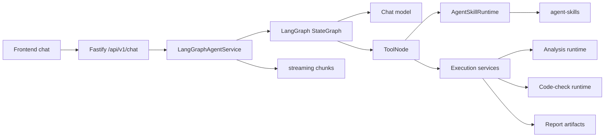

# Agent 架构

本文档描述 StructureClaw 1.0.0 当前正在运行的 agent 架构。它是面向贡献者的代码对齐参考，不是规划文档。

### 模型契约与职责边界

节点、构件和荷载的局部补丁在明确删除操作之后，结合相同 ID 对象已接受的字段进行校验，无须让模型每次重复坐标、连接和单位。其他对象、其他组合及未修改的组合系数继续保留；旧技能状态中的草稿只是合并后草稿的兼容视图。仅撤回字段对应的诊断被清除，其他冲突及原始证据保留。

“整个材料组缺失”的诊断复用模板建模的材料投影：已支持的明确牌号或完整材料记录均可满足该条件。未知牌号、不完整的显式记录、指定对象或字段缺项、来源冲突仍保留。投影只读，不另存一份可写材料数据。

聊天与运行时抽取入口共用同一个 LLM 抽取器及更新协议。省略字段表示不变，记录数组按稳定 ID 合并。用户明确撤回字段时，抽取结果使用 `clearDraftFields: ['sectionRecords["S1"].standard_steel_name']`，随后再合并本轮 `engineeringDraft`。删除先在副本上核对全部目标，成功后一起提交；对象 ID、原始证据不能当普通字段删除。工具返回实际执行的清除项及更新后的草稿。改变形状不再自动删掉用户给过的属性；替换定义必须明确清除旧定义。没有通过自然语言关键词或正则猜删除意图。

截面 `name` 是显示名称；型号不查询任何目录（已无截面目录）。含四项尺寸的型号（`HN300×150×6.5×9`、`H300x150x6.5x9`）按无圆角的 H×B×tw×tf 明确几何读取，并在报告中说明；缺少板厚的型号（`HN300×150`）只发起一次澄清，询问 tw/tf 或完整截面属性。`standard_steel_name` 仅为 PKPM/YJK 原生选择器，型号解析为几何时将其移除；几何与属性矛盾仍由正式校验拒绝。自重可以归入全模型仅有的 `other` 分析工况，并记录 `sole-unclassified-case` 依据，不把它改名或改为恒载；存在多个候选工况时仍须明确目标。

大模型负责理解请求、识别缺项和提出模型字段。确定性程序负责单位、物理一致性、证据、编辑和运行身份校验，然后调用所选求解器。材料与截面参考表、几何计算仍由确定性代码处理，其中不能写入某个例题的答案。

Python 的 `StructureModelV2` 是物理字段的权威定义。`backend/scripts/export-model-contract.py` 导出受版本管理的 JSON Schema，供参数抽取与通用建模提示使用。草稿只增加便捷输入字段，物理记录及 `coordinateSystem`、`analysisControl` 引用同一模型定义。分析维度必须来自请求，不能仅凭节点共面认定二维。旧标量字段只在入口转换。模板不再自动添加“全部工况系数均为 1”的 `ULS` 组合；组合必须有明确给定的系数。

草稿诊断区分 `kind: missing` 和 `kind: confirmation`。缺项按当前字段值和类型重新判断；待确认项需要明确的新字段值，来源冲突继续保留。运行时绑定的路径通过稳定 ID 跟随对象，不因数组重排串到另一个对象。`invalidDraftFields` 是兼容视图，不再独立维护一份缺项清单。旧会话中已有值但含糊的诊断仍保守处理。包括显式模型导入在内的所有建模入口都不能绕过未解决的物理输入。

默认建模方式仍为 `auto`。选择 `llm` 时跳过模板专属的层数、跨数与配方条件，部分拓扑交给 LLM 补全，正式模型校验仍然执行。完整导入模型仍走保留原始信息的导入路径，记录实际 `builder: explicit` 和用户选择的策略；`auto` 还会直接装配完整的显式拓扑。真正的 LLM 建模读取模型 Schema，纠错时收到上次候选模型和具体校验错误。模型返回 `missing_fields` 时正常请求澄清，不记为工具失败、不消耗纠错次数；无效候选的自动修正仍受统一预算限制，传输失败不伪装成语义纠错。

设计输入（设计强度、稳定系数、限值、计算长度、使用工况）不属于草稿诊断：抽取时丢弃设计字段缺项，因此不会阻断分析流程，也不会被追问。只有用户明确给出时才保存。明确请求的规范校核自行确定规范可确定的数值，并在 `designValues` 中记录每个数值及其来源（校核输出、交付说明和报告均显示）：GB 50017-2017 的 f、fv、fy 按牌号和控制板厚查表 4.4.1（H 形截面取翼缘厚）；截面特性按几何计算；β1 按 6.1.5 取 1.1（模型未计算局部压应力）；εk 按牌号屈服点；宽厚比限值按表 3.5.1 S4 级（6.1.1 采用全截面模量、γx=1.0 所需）；长细比限值仅对柱按表 7.4.6 取值。GB 50010 的 fc、ft 及钢筋 fy 按混凝土强度等级和钢筋牌号查表。各表集中在 `skill-shared/python/structure_protocol/design_code_tables.py`。模型中给出的数值优先。工程判断输入（侧向支承/计算长度 → φb、l0；挠度限值类别 → L/n；使用工况）不默认取值，列为缺项。混凝土框架的钢筋牌号也属于校核输入：弹性分析从不需要它。

只求内力（内力、反力）时不需要材料和截面。静力且只求内力/反力的请求（`requestScope.design=false`、不计自重、不指定商业引擎）未声明材料和/或截面时，模板建模使用标注的单位刚度占位（`engineering/stiffness-placeholder.ts`），并在 `metadata.stiffnessPlaceholder` 记录超静定次数。静定结构的内力与刚度无关；超静定结构按各构件 EI 相同求解，`build_model`/`run_analysis` 返回 `equalStiffnessAssumed=true`，回答中须说明该假定。部分构件声明了截面而其余未声明时仍会询问。占位运行的位移从不展示：run_analysis 摘要和前端分析数据去除位移，`query_results` 拒绝位移查询，`generate_report` 拒绝该运行（`STIFFNESS_PLACEHOLDER_RUN`）；保存的运行仍保留求解数据以便恢复内力。之后请求位移、周期或设计时不再满足只求内力的条件，草稿会询问实际材料和截面；`run_code_check` 对占位模型返回 `STIFFNESS_PLACEHOLDER_MODEL`，原生设计复核也以该原因报告不可用。`edit_model` 为所有构件给出实际材料和截面（更新占位记录的刚度或指定新记录）后，移除占位标记、未再使用的占位记录及 `metadata.stiffnessPlaceholder`；只改了一部分时仍是占位模型。不再有单独的平衡计算路径：旧平衡捷径（引擎 `builtin-equilibrium`）保存的运行只读加载，查询其未保存的字段返回 `RESULT_FIELD_UNAVAILABLE`；已保存的 `requestScope.method` 被接受但忽略。

## 1. 运行时形态

StructureClaw 使用 capability-driven agent：

```text
前端对话界面
  -> Fastify chat API
  -> LangGraph ReAct agent
  -> 已注册 tools
  -> skill runtime 与后端执行服务
  -> 流式 assistant presentation
```

agent 不是 mode-driven。普通对话可以停留在基础 LLM 路径；工程请求则可以启用 skill 和 tool，完成草稿提取、模型校验、分析、规范校核和报告生成。



## 2. 对外入口

chat routes 位于 [backend/src/api/chat.ts](../backend/src/api/chat.ts)，挂载在 `/api/v1/chat` 下：

- `POST /api/v1/chat/message`：同步对话执行。
- `POST /api/v1/chat/stream`：SSE 流式对话（由 [backend/src/api/chat-sse.ts](../backend/src/api/chat-sse.ts) 中的 `runSseTurn` 处理）。
- `POST /api/v1/chat/stream/resume`：恢复一次暂停的交互。
- 会话创建、列表、snapshot、session 与消息路由也在同一模块中。

agent capability、运行、审阅与 SkillHub routes 位于 [backend/src/api/agent.ts](../backend/src/api/agent.ts)，挂载在 `/api/v1/agent` 下：

- `GET /api/v1/agent/skills`、`GET /api/v1/agent/tools`、`GET /api/v1/agent/capability-matrix`
- `GET /api/v1/agent/run-profiles`：消融实验 profile 目录（见 [ablation_CN.md](./ablation_CN.md)）。
- `POST /api/v1/agent/run` 与 `POST /api/v1/agent/resume`：agent 编排入口与恢复已保存的澄清问题。
- `GET` / `POST /api/v1/agent/input-review/:conversationId[/tools]` 与 `GET` / `POST /api/v1/agent/result-review/:conversationId[/tools]`：输入证据与结果复核面板。
- `GET /api/v1/agent/skillhub/search`、`GET /api/v1/agent/skillhub/installed`，以及 `POST /api/v1/agent/skillhub/{install,enable,disable,uninstall}`。

后端分析运行时入口位于 [backend/src/api/analysis-runtime.ts](../backend/src/api/analysis-runtime.ts)，注册时不带 `/api/v1` 前缀：

- `POST /validate`、`POST /convert`、`POST /analyze`、`POST /code-check`
- `GET /runs/:id`、`GET /analysis-requests/:id`、`POST /analysis-requests/:id/{cancel,recover}`
- `GET /schema/structure-model-v1`、`GET /schema/structure-model-v2`、`GET /schema/converters`
- `GET /engines`、`GET /engines/:id`、`POST /engines/:id/check`

## 3. 分层与核心运行时文件

后端分为七层，从 L0（shared）到 L6（delivery）。[backend/.dependency-cruiser.cjs](../backend/.dependency-cruiser.cjs) 负责强制执行这些规则；修改跨模块 import 后运行 `npm run check:deps --prefix backend`。低层不得 import 高层，文件级 import 循环视为错误。

| 层级 | 位置 | 内容 |
|---|---|---|
| L0 shared | `backend/src/shared/`（`locale.ts`、`types/agent.ts`）、`backend/src/types/` | 跨层类型与语言解析。 |
| L1 kernel | `backend/src/runtime/`、`backend/src/config/`、`backend/src/utils/`、`backend/src/generated/` | 运行策略与运行上下文、工具调用上限、消融 profile、配置加载、Prisma client、日志与通用工具。 |
| L2 domain | `backend/src/engineering/`、`backend/src/skill-shared/`、`backend/src/agent-skills/` | 结构模型契约、截面几何、求解与规范校核逻辑，以及 skill 实现。 |
| L3 agent-core | `backend/src/agent-runtime/` | skill loader 与 registry、`AgentSkillRuntime`，以及草稿边界（`draft/`）。 |
| L4 services | `backend/src/services/` | capability 元数据、分析与规范校核执行 client、chat 持久化、会话与记忆服务。 |
| L5 agent-host | `backend/src/agent-langgraph/` | LangGraph graph、tools、tool context、最终回答交付、会话 snapshot、附件。 |
| L6 delivery | `backend/src/api/`、`backend/src/index.ts` | Fastify routes 与 SSE 传输。 |

依赖规则有两处有意保留的例外：

- `runtime/policy-settings.ts` 是 `agent-langgraph/policy-resolver.ts` 的 re-export 兼容垫片，因为 `integrations/openclaw/worker.mjs` 仍导入旧路径。
- 结构类型与截面 skill handler 可以导入固定列表中的 agent-runtime skill-handler SDK 模块（`SKILL_HANDLER_SDK`）。其他 L2 模块不得导入 L3。

| 区域 | 文件 | 职责 |
|---|---|---|
| Agent service | [backend/src/agent-langgraph/agent-service.ts](../backend/src/agent-langgraph/agent-service.ts) | 创建单例 `LangGraphAgentService`；负责 streaming、同步、run 与 resume 入口、会话创建、checkpointer 配置和执行 client 注入。附件与地震动处理（`attachments/`）、初始消息构造、会话 snapshot（`session/snapshot.ts`）以及每轮的工具访问策略与递归上限（`turn-config.ts`）已从中拆出。 |
| Graph | [backend/src/agent-langgraph/graph.ts](../backend/src/agent-langgraph/graph.ts) | 构建 LangGraph ReAct 循环（`START -> agent -> tools -> agent -> END`）以及每个节点的 tool context。 |
| 运行策略 | [backend/src/runtime/run-policy.ts](../backend/src/runtime/run-policy.ts)、[run-policy-schema.ts](../backend/src/runtime/run-policy-schema.ts)、[run-context.ts](../backend/src/runtime/run-context.ts) | 每轮解析一次的 `EffectiveRunPolicy`，由 `createRunContext` 冻结；请求与设置输入的 Zod schema；运行用量。 |
| 策略解析 | [backend/src/agent-langgraph/policy-resolver.ts](../backend/src/agent-langgraph/policy-resolver.ts) | 为 `runtime/run-policy.ts` 的 `resolveRunPolicy` 组装各层输入：设置、`config/index.ts` 中读取的 `SCLAW_RUN_PROFILE`、skill 目录与请求字段。 |
| Tool context | [backend/src/agent-langgraph/tool-context.ts](../backend/src/agent-langgraph/tool-context.ts) | `deriveToolContext` 根据策略和 checkpoint 状态生成冻结的 `ToolContext`（生效 tool ID、skill 范围、工具调用预算、文件白名单）。tools 只从中读取 skill 范围与文件白名单；直接调用 tools 的宿主（脚本、测试）在 `configurable` 上传入 `toolContext`。 |
| 消融 profile | [backend/src/runtime/ablation-profiles.ts](../backend/src/runtime/ablation-profiles.ts) | 预注册 profile（`ABLATION_PROFILES_VERSION`）、策略预设与能力分组。见 [ablation_CN.md](./ablation_CN.md)。 |
| 上限 | [backend/src/runtime/limits.ts](../backend/src/runtime/limits.ts) | `DEFAULT_MAX_TOOL_CALLS_PER_TURN`（200）以及用户可配置项的上限。 |
| State | [backend/src/agent-langgraph/state.ts](../backend/src/agent-langgraph/state.ts) | graph state channels：messages、locale、已选 skills、草稿状态、artifacts 与运行策略。 |
| Prompt | [backend/src/agent-langgraph/system-prompt.ts](../backend/src/agent-langgraph/system-prompt.ts) | 根据已选 skill manifests、当前 state 与策略构建双语 system prompt。 |
| Tool 聚合导出 | [backend/src/agent-langgraph/tools.ts](../backend/src/agent-langgraph/tools.ts) | 从 `tools/` 重新导出工程工具的 factory 与辅助函数。 |
| 工程工具 | [backend/src/agent-langgraph/tools/](../backend/src/agent-langgraph/tools/) | 工作流工具各自一个模块（结构类型识别、参数提取、建模、校验、运行分析、规范校核、报告、澄清、会话配置），另有共享辅助模块（`shared.ts`、`draft-helpers.ts`、`analysis-resolution.ts`、`input-message.ts`）及 `compaction/`、`seismic-workflow/` 子目录。模型编辑类工具（`review_input`、`query_model`、`edit_model`、`undo_model`、`query_results`）位于 `model-tools.ts`。 |
| Tool registry | [backend/src/agent-langgraph/tool-registry.ts](../backend/src/agent-langgraph/tool-registry.ts) | 声明内置 tools（ID、分类、风险等级、双语元数据、factory）并构建 tool set。位于其他模块中的工具（`model-tools.ts`、`workspace-tools.ts`、`file-tools.ts`、`shell-tool.ts`、`memory-tool.ts`、`calc-tool.ts`）也在此注册。 |
| Tool policy | [backend/src/agent-langgraph/tool-policy.ts](../backend/src/agent-langgraph/tool-policy.ts) | 解析 enabled / disabled tool ID；shell gate 未开启时阻止 shell tool。 |
| 用户 tools | [backend/src/agent-langgraph/user-tool-loader.ts](../backend/src/agent-langgraph/user-tool-loader.ts) | 加载 workspace tool 定义，并在 graph 构建时追加。 |
| 最终回答 | [backend/src/agent-langgraph/delivery/final-answer.ts](../backend/src/agent-langgraph/delivery/final-answer.ts) | `applyFinalAnswerPolicy` 将空的最终模型回复替换为双语兜底文本。 |
| 草稿边界 | [backend/src/agent-runtime/draft/boundary.ts](../backend/src/agent-runtime/draft/boundary.ts) | 唯一的草稿边界：`ingestDraft` 将抽取补丁（包括 `clearDraftFields`）合并进已有草稿；`projectDraftState` 派生状态视图。辅助模块位于 `draft/normalize.ts`、`draft/project-patch.ts` 与 `draft/legacy-fields.ts`。 |
| Skill runtime | [backend/src/agent-runtime/index.ts](../backend/src/agent-runtime/index.ts) | `AgentSkillRuntime`：manifest 列表、结构类型识别、模型构建，以及分析、规范校核、校验与报告 skill 的执行。 |
| Skill loader | [backend/src/agent-runtime/loader.ts](../backend/src/agent-runtime/loader.ts) | 发现 skill 目录，加载阶段 Markdown，并导入可选 handler。 |
| Skill registry | [backend/src/agent-runtime/registry.ts](../backend/src/agent-runtime/registry.ts) | 按 ID、结构类型和 domain 解析 skills / plugins。 |
| 分析目录 | [backend/src/agent-skills/analysis/catalog.ts](../backend/src/agent-skills/analysis/catalog.ts) | 内置分析 skill 的唯一 engine 目录（ID、engine ID、分析类型），由各 `skill.yaml` 派生，并提供 `run_analysis` 的 skill 枚举。 |
| Capability API | [backend/src/services/agent-capability.ts](../backend/src/services/agent-capability.ts) | 根据 skills、tools 与 engine 可用性生成前端 capability 元数据。 |
| 执行 client | [analysis-execution.ts](../backend/src/services/analysis-execution.ts)、[code-check-execution.ts](../backend/src/services/code-check-execution.ts)、[structure-protocol-execution.ts](../backend/src/services/structure-protocol-execution.ts) | agent tool 层使用的本地 client，以及结构校验与转换辅助函数。 |
| Chat 持久化 | [backend/src/services/chat-persistence.ts](../backend/src/services/chat-persistence.ts) | 为 chat routes 持久化 assistant 消息、调试详情、最新结果与会话状态。 |

## 4. ReAct 循环

当前 graph 很小：

1. `agent` node 构建双语 system prompt，依据冻结的运行策略与 checkpoint 状态为该节点导出 `ToolContext`，绑定 active tools，调用 chat model；一旦达到本轮工具调用预算即以警告结束本轮。预算即生效运行策略中的 `budgets.maxToolCallsPerTurn`，来自设置中的 `agent.maxToolCallsPerTurn`；默认 200，上限同为 200（`runtime/limits.ts`）。
2. `shouldContinue` 检查模型是否返回 tool calls。
3. `tools` node 为该节点构造新的 config（`{ ...config, configurable: { ..., agentState, toolContext } }`），在本轮 run context 中按顺序执行调用，并把 artifacts 写回 graph state。策略通过 `toolContext` 和 `runContext` 传给 tools；共享的 `configurable` 不会被写入策略字段。
4. 控制流回到 `agent`，直到模型不再请求 tool call。

`agent` node 仍会把当前 state snapshot 写入 `config.configurable.agentState`，以便 tools node 读取 state channels；这是 `configurable` 中唯一保留的原地写入。

compiled graph 在进程生命周期内缓存。skill 或 tool 变化后，可以通过 `LangGraphAgentService.resetGraph()` 重建。

### 防护层

调用哪个工具、何时停止由 LLM 决定。通用防护层只处理不合理的调度或输出；它不匹配用户文本，正常路径上不起作用。每次干预都记录为 `kind: "guard"` 运行事件（`guard`、`action`），并计入 `usage.guards`。

| 防护 | 阈值 | 位置 |
|---|---|---|
| 相同失败重复：同一工具、语义相同参数（忽略键序与空值）以同一错误码失败 | 失败 2 次；第 3 次相同调用不执行，返回 `REPEATED_FAILED_CALL`，附先前错误与修改建议 | `guards/tool-guards.ts`，由 `sequential-tools.ts` 在预算账本之前调用 |
| 无进展：调用未改变任何状态值（模型、草稿、分析、报告、校核、查询数值等）且重复先前成功调用，或调用失败 | 连续 8 次结束本轮 | 同上 |
| 重复澄清：`ask_user_clarification` 的规范化问题与本轮或上一轮在相同模型版本和草稿下已回答的问题相同（二元组相似度 ≥ 0.8；模型或草稿改变后可再次询问） | 以 `DUPLICATE_CLARIFICATION` 拒绝并附已保存的回答 | 同上 |
| 未知工具 / 参数格式错误 / 缺少调用 ID | `UNKNOWN_TOOL` 附 `availableTools`；`MALFORMED_TOOL_ARGUMENTS`；自动生成 ID | `tool-guards.ts`、`guards/response-guards.ts`（agent 节点） |
| 防护拒绝次数 | 每轮 2 次（`repair.enabled` 为 false 时 1 次）结束本轮 | `tool-guards.ts`；agent 节点不再调用 LLM，由 `guards/stop-answer.ts` 给出已完成步骤、可用结果与受阻事项 |
| 工具异常 | ToolNode 文本转为 `{ success: false, errorCode, error, hint }`；未知 ID 错误码（`RUN_NOT_FOUND`、`RESULT_NODE_NOT_FOUND`、`MODEL_OBJECT_NOT_FOUND` 等）列出现有 ID | `guards/tool-errors.ts` |
| 最终回答数值：带工程单位（kN/N、kN·m/N·m/N·mm、m/mm、MPa/kPa/Pa、kN/m、rad、Hz）的数值，经单位换算、忽略符号、容差取 max(末位半个单位, 1 %) 后，与用户消息、任一工具结果及已保存的模型/草稿/分析/校核/报告/查询数值均不一致；用户输入数值的乘积/商（q·L、P/2）及已保存查询数值之和（ΣR）也视为依据；引用规范表/条文的句子和紧跟书面公式的数值（`L/250 = 24 mm`、`L/250 (24 mm)`、`22.5 + 75 + 22.5 = 120 kN`、`120 kN = 10×12`，以及回答中其他位置的同一数值）不检查；面积、体积和惯性矩（`cm⁴`、`mm²`）不检查 | 每轮 1 次纠正请求（关闭自动纠错时为 0），之后附注列出未核实数值 | `delivery/answer-integrity.ts`、`answer-review.ts`、`final-review.ts` |
| 声称的操作（窄化的中英文模式，忽略否定与条件句）与当前状态不符："已完成分析"需当前有效分析，"已生成报告"需该运行的报告，"验算通过"需该运行且 `complianceStatus: pass` 的规范验算。数值证据中的单位刚度占位运行不含位移 | 同样先纠正后附注 | 同上 |
| 空回答或被截断的回答 | 空回答替换为双语兜底文本；`finish_reason` 为 `length`/`max_tokens` 时附截断提示 | `delivery/final-answer.ts`、`final-review.ts` |

防护账本随运行上下文（一轮或恢复后的一段）存在，不持久化。被防护拒绝的调用不会预留预算、不会执行，也不改变状态。

## 5. 内置 Tool Set

内置 tool registry（`tool-registry.ts` 中的 `AGENT_TOOL_DEFINITIONS`）定义了以下 25 个 tool ID：

| 分类 | Tool IDs |
|---|---|
| Engineering | `detect_structure_type`、`extract_draft_params`、`build_model`、`validate_model`、`run_analysis`、`run_code_check`、`generate_report`、`calculate`、`review_input`、`query_model`、`edit_model`、`undo_model`、`query_results` |
| Interaction | `ask_user_clarification` |
| Session | `set_session_config` |
| Memory | `memory` |
| Workspace | `analyze_file`、`glob_files`、`grep_files`、`read_file`、`write_file`、`replace_in_file`、`move_path`、`delete_path` |
| Shell | `shell` |

每个工具都有风险等级（`low`、`workspace-read`、`workspace-write`、`destructive` 或 `shell`）。破坏性工具与 shell 工具的门禁最严格。

tool 选择是 request-scoped：

- 如果请求没有显式 enabled list，则默认启用的 tools 可用。
- `disabledToolIds` 会从 active set 中移除 tools；运行策略中被禁用的 tools 也会加入其中。
- `shell` 需要 agent 配置中的 shell gate 允许。
- 未知 tool ID 会由 policy resolution 返回。

工程工具从 graph state 中读取 model、analysis、report 和 draft artifacts，而不是依赖大型序列化参数（见第 8 节）。

## 6. Skill 模型

Skills 是 [backend/src/agent-skills](../backend/src/agent-skills) 下的 filesystem-backed capabilities。每个 skill 由 `skill.yaml` 描述，并可包含阶段 Markdown 与可执行 handler。

最小可发现结构：

```text
backend/src/agent-skills/<domain>/<skill-id>/
  skill.yaml
  intent.md        # 可选阶段内容
  draft.md         # 可选阶段内容
  analysis.md      # 可选阶段内容
  design.md        # 可选阶段内容
  handler.ts       # 可选 TypeScript handler
  runtime.py       # 可选 Python runtime
```

运行行为由 domain 决定：

- `structure-type` skills 使用 `handler.ts` 识别结构类型、提取草稿、询问缺失信息并构建 StructureModel JSON。
- `analysis` skills 选择 OpenSees、PKPM、YJK 等后端分析 adapter。
- `code-check` skills 选择设计规范校核行为。
- 其他 domains 可能是 catalog-visible、partial wired 或 reserved。当前成熟度见 [skill-runtime-status_CN.md](./skill-runtime-status_CN.md)。

## 7. 稳定 Skill Domains

domain taxonomy 由 [backend/src/shared/types/agent.ts](../backend/src/shared/types/agent.ts) 中的 `ALL_SKILL_DOMAINS` 定义：

- `structure-type`
- `analysis`
- `code-check`
- `data-input`
- `design`
- `drawing`
- `general`
- `load-boundary`
- `material`
- `report-export`
- `result-postprocess`
- `section`
- `validation`
- `visualization`

taxonomy 是稳定的，但 domain 成熟度不同。domain 可以处于：

- `active`：已接入主执行路径。
- `partial`：可发现，并且部分接入运行时。
- `discoverable`：对 catalog / capability APIs 可见，但不会自动参与主 tool flow。
- `reserved`：属于 taxonomy，但当前没有内置实现。

## 8. 工程管线

当前 prompt 与 tools 会引导结构请求经过这条管线：

```text
识别结构类型
  -> 提取并合并草稿参数
  -> 必要时询问关键缺失的分析输入
  -> 构建 StructureModel
  -> 校验模型
  -> 执行分析
  -> 生成报告（仅在要求时，见下文）
  -> 停止：总结结果并提示下一步（规范验算、修改模型）
```

意图判断由大模型完成：是否校核、是否出报告以及需要哪些响应，均通过提示词和工具说明引导，并在工具参数中声明（`requestScope`）。校核、报告与所求响应的判断不匹配用户文本。固定文本模式仍有四处：技能检测器为大模型结构路由提供参考性的规则提示，路由输出不可用时也作为回退（通用技能是任意消息的回退，不再对文本做关键词判断）；不支持结构（`网架`/space frame）的规则在路由之前返回不支持；显式结构切换模式会释放当前草稿；模板荷载布置读取大模型抽取的自由文本 `loads[].target` 标签（楼层序号、屋面/顶层、夹层/吊车、X/Y 向梁），因为草稿没有这些信息的结构化字段。“设计一个梁”即执行上述默认流程，不构成校核请求；用户要求校核时代理才调用 `run_code_check`（声明 `requestScope.design=true`），仅当用户要求报告、计算书或其他交付文件时才调用 `generate_report`（`requestScope.report`），“设计一个梁”和只求具体结果都不是报告请求。抗震分析同样如此：校核和报告仅在要求时执行。工具不再复核这些决定，只校验状态和前提条件（有当前分析、结果未过期、ID 和参数有效、校核/报告/位移查询不基于单位刚度占位运行），并返回带中英文恢复提示的结构化错误。默认流程中的澄清只询问所求结果需要的分析输入（几何、支座、荷载、材料弹性属性、截面尺寸或属性）。明确请求的校核不会因设计输入缺失而中断：工具返回 `nextAction: "report_missing_inputs"`，最终回复列出已完成的校核以及未执行项和所缺输入，用户可在后续轮次补充。

LLM 抽取器与 skill handler 产生的草稿补丁由 `ingestDraft`（`agent-runtime/draft/boundary.ts`）归一化，skill handler 直接调用该函数。未提供的字段保持不变，记录数组按稳定 ID 合并，明确删除通过 `clearDraftFields` 完成。tools 从 graph state 中读取 model、analysis、report 和 draft artifacts。LLM 不应该在 tools 之间传递很大的 `modelJson`、`analysisJson` 或 `stateJson` 参数。

## 9. 分析执行

分析 tool calls 通过 `AgentSkillRuntime.executeAnalysisSkill()` 和本地分析 client 执行：

```mermaid
flowchart LR
  Tool[run_analysis tool] --> Runtime[AgentSkillRuntime]
  Runtime --> Select[Selected analysis skill]
  Select --> Client[Local analysis client]
  Client --> API[/analyze]
  API --> Registry[Engine registry]
  Registry --> OpenSees[OpenSees]
  Registry --> PKPM[PKPM]
  Registry --> YJK[YJK]
  OpenSees --> Result[AnalysisResult]
  PKPM --> Result
  YJK --> Result
```

分析选择会使用请求中的 analysis type、engine ID、selected skill IDs、supported model families 以及 skill manifest 元数据。skill ID、engine ID 与分析类型均来自 `agent-skills/analysis/catalog.ts` 这一唯一目录；`backend/tests/analysis-skill-catalog.test.mjs` 检查该目录与 `skill.yaml` manifests 一致。如果没有兼容的 analysis skill 被选中，runtime 不会静默挑选 engine，而会通过 tool path 返回绑定错误。

## 10. 会话状态与流式输出

`LangGraphAgentService` 创建或复用 conversation record，分配 trace ID，并通过 [backend/src/agent-langgraph/streaming.ts](../backend/src/agent-langgraph/streaming.ts) 流式输出 LangGraph 结果。chat API 会把 stream events 归约成 assistant presentation object，用于持久化和前端渲染。`/stream` 使用 `runSseTurn`；`/stream/resume` 在 `api/chat.ts` 中有自己的 SSE 处理函数。两者都通过 `services/chat-persistence.ts` 持久化。

Graph checkpoint 数据通过 [backend/src/agent-langgraph/file-checkpointer.ts](../backend/src/agent-langgraph/file-checkpointer.ts) 存储，路径由 [backend/src/agent-langgraph/config.ts](../backend/src/agent-langgraph/config.ts) 中的 agent 配置辅助函数解析。

每次工具节点只执行一个调用，保存状态更新与工具响应后，再执行下一个待处理调用。后续澄清问题触发暂停时，恢复会从该调用继续，不重放之前已完成的模型修改。自定义工具仍需避免在同一个调用的暂停点之前产生副作用。

## 11. 扩展边界

当前有两个扩展面：

- Skills：built-in 和 workspace skills 通过 `AgentSkillRuntime`、`AgentSkillLoader` 与 manifest validation 加载。
- Tools：built-in tools 由代码拥有；workspace tools 由 `user-tool-loader.ts` 加载，并在 graph 构建时追加到 tool registry。

高风险 tools 仍受 policy gate 约束。尤其是 shell execution，只有配置中的 shell gate 允许时才可用。

每次运行只会在一个预注册的消融 profile 或完整系统下执行。profile 只移除一种机制，工具、接口与求解器保持不变，因此 agent 仍会以回答结束本轮。profile 的选择优先级与记录字段见 [ablation_CN.md](./ablation_CN.md)。

## 12. 贡献者规则

- 将本文档视为 1.0.0 实现快照。
- 不要把不存在的模块或计划中的文件写成当前架构。
- 产品行为变化时，公开文案需要保持中英文一致。
- 修改 agent 架构时，同步更新本文档和 `agent-architecture.md`。
- 修改 import 后运行 `npm run check:deps --prefix backend`；新增跨层 import 时，必须同时更新分层规则和本节。
- 新增、删除或改变 skill-domain 成熟度时，同步更新 [skill-runtime-status_CN.md](./skill-runtime-status_CN.md)。
