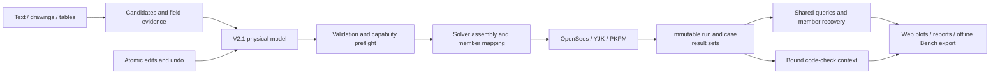

# Engineering core V2.1 / 工程内核重构

This records an implemented core and its acceptance boundaries. It does **not**
certify all 300 planned tasks or every commercial capability. Historical paper
tags, experiments and reference data remain unchanged.

本记录说明已落地的内核及验收边界，**不代表新300题或所有商业软件能力已经完成**。
历史论文标签、实验与标答保持不变；候选冻结不能掩盖剩余缺口。

Frozen implementation and machine-readable test evidence:
[engineering-v2.1-preview-20261013](./reproducibility/engineering-v2.1-preview-20261013.json).
Final verification: backend **1339/1339**, frontend **273 passed / 6 existing todo**,
evaluator **38/38**, and **51/51** engineering regression steps. Backend and frontend
build/lint passed. The final stale-summary guard also passed its 11 focused tests
and frontend type check. These counts do not certify unaccepted native capabilities.

冻结版本与机器可读验收记录见上方清单。后端最终测试零跳过；商业原生能力、完整300题和模型答题
成功率均不能由这些软件回归计数代替。

## Architecture / 统一链路



LangGraph and HTTP/local clients share engineering services. `model` is the writable
physical source; drafts are candidates and history snapshots are read-only.
SQLite `physicalModel` retains full V2 information; old columns are compatibility
projections. Migration adds nullable columns, preserving existing records.

草稿是候选信息，模型是唯一可写物理来源，历史快照不再修改。
SQLite 增加完整 `physicalModel`，旧几何字段仅作兼容视图；本机迁移先备份、在副本验证，
再增加可空字段。V1/V2 可以显式转换到 V2.1，旧输入仍可按 V2.0 读取。

## Contracts / 核心约定

| Interface / 接口 | Behavior / 行为 |
|---|---|
| `query_model` | Revision, stable IDs, history / 当前版本、稳定对象ID及历史 |
| `edit_model` | `baseRevision`, atomic add/update/remove; move the same load ID / 按基础版本原子修改，荷载移动保留ID |
| `undo_model` | Before-state becomes a new revision; conflicting later changes rejected / 恢复为新版本，后续冲突明确拒绝 |
| `run_analysis` | `loadCaseIds`, `loadCombinationIds`; separate static cases and combinations / 工况与组合分别计算 |
| `query_results` | Run, case, member and position in metres; optional left/right side / 查询运行、工况、构件及米制位置，支持断点左右侧 |
| HTTP code check | `modelId`, persisted `analysisId` and matching `runId`/settings / 必须提供模型、持久分析任务与匹配运行ID及设置 |

Physical changes immediately invalidate current results, checks and reports while
retaining historical runs. Sessions serialize writes; publication compares the
model fingerprint. Each tool call is checkpointed before another can interrupt,
so clarification/resume does not repeat earlier model edits.

物理修改后旧结果立即失去当前有效状态，但仍保留历史。同一会话串行写入，晚返回的结果检查
模型指纹；每个工具调用单独保存检查点，暂停恢复不重做已完成的修改。

`results['case:D']` and `results['combination:U']` are independent. The old `data`
field only mirrors `selectedResultKey`. `runs/<runId>/run.json` stores input,
settings, fingerprints, solver metadata, timestamps and results, including failed
children. Execution, capability completeness and compliance are separate fields.

不得擅自把 D/L/W 相加，也不得用首个工况冒充全部工况。图、表、查询和报告逐工况消费相同结果。
调用者提供的利用率不能覆盖真实计算。旧结果没有可匹配的模型指纹时，只能历史查看。

Legacy selection aliases are normalized at the request boundary; conflicting
aliases and empty explicit selections fail. Solver parameters cannot replace
the physical model's loads. Input-conflict resolutions cover identified evidence;
later contradictory or unread evidence requires a new resolution.

旧工况参数名只在入口转换，互相冲突或明确为空的选择会被拒绝。求解参数不能另带一套荷载替换
物理模型；来源冲突的确认绑定已审定证据，不能永久豁免以后出现的新矛盾或未读信息。

Stateless `/analyze` archives a run but does not create a database analysis task.
Formal HTTP `/code-check` uses the persisted model → task → run workflow; an arbitrary
uploaded context or stateless run alone is insufficient. The agent's internal
bound workflow continues through the same checked model/result services.

无状态 `/analyze` 保存运行文件，但不创建数据库分析任务。正式 HTTP 校核需先走持久化
模型→任务→运行流程，仅上传上下文或无状态运行ID不能直接进入验算；agent内部仍使用绑定模型和结果的公共服务。

## Units / 单位

Coordinates m; forces kN; moments kN.m; E/G MPa; density kg/m3; section dimensions
mm; A m2; I/J m4; nodal dynamic mass tonne. Member point-load positions and
distributed start/end are metres. Existing piecewise ordinate positions remain
fractions of member length. Conflicting explicit units are rejected.

沿用明确单位，不按数值大小猜测。跨内点力及分布起止位置使用米，已有折线载荷采样点位置保留
构件长度比例约定。500 N 从输入层明确转成0.5 kN；V2字段带冲突单位时不能忽略单位执行。

## Consolidation / 已落地的精简

- Templates provide geometry and explicit member roles. Shared property resolution
  uses declared material/section records or `templateAssignments`. Unknown properties
  block modeling. / 模板不再填默认惯性矩或擅自替换牌号，梁柱角色明确。
- Static, dynamic and seismic modal methods share OpenSees assembly; real truss and
  mixed-brace execution replace the production matrix solver. Point/partial/linear
  member loads retain solver-to-physical station maps. / 矩阵算法仅作测试参考。
- Nodal mass and density mass are not implicitly added. Seismic story mass requires
  an explicit basis. / 不再猜测楼层质量或重复计入质量。
- Commercial compilers preserve natural-floor topology and per-member sections.
  Formal V2 execution remains gated until native material-property preservation is
  calibrated. / 商业转换器不补齐矩形网格；原生材料属性尚未校准，正式V2计算仍被门禁阻断。
  原生证据见[验收记录](./commercial-native-acceptance.md)。
- Code checking preserves simultaneous signed station vectors and evaluates stations
  before choosing a controlling result. Missing data/unsupported rules stay incomplete.
  / 不生成假利用率，不补假配筋，单轴公式及筛查方法保留适用范围。
- DXF uses ezdxf, PDF pages use PDF.js, CSV uses csv-parse. Source locations and
  truncation are retained. Required conflicts stay in `inputEvidence` until explicitly
  resolved. / 保留文件、页、实体和表格行来源；普通分页不等于全部页都是必要输入。
- `skill-shared/member-response.ts` owns member recovery. Runtime consumers share it;
  Bench reads a separately exported hashed cache and builds independently.
  / 不改写冻结标答，不用生产恢复算法替代独立标答验证。

## Acceptance / 验收

```powershell
$env:SCLAW_DATA_DIR='<runtime-data-directory>'
npm --prefix backend run build
node backend/tests/engineering-native-acceptance.mjs
node tests/runner.mjs analysis-regression
```

The native test uses no paid model API. It freezes elementary beam formulas before
execution, checking 500 N point load, partial uniform load, D/L/U separation,
reactions, member deflection, shear jump, load movement, undo, history and bilingual
report consistency. Absolute/relative tolerances are 1e-10/1e-8, without relaxation.

真实验收覆盖输入转换、求解、后处理、修改及交付，不是只有 mock。
工程回归51项通过，包括63/63转换往返；Python静力39、动力7、抗震78（另9个子测试）、
协议72、规范校核235项通过。最终应用测试和冻结版本记入验收清单。

Bench compares physical equivalence and signed, explicitly selected results.
Reviewed straight-member subdivision/re-numbering is accepted; wrong connections,
supports, load positions/signs and missing cases fail. Historical `matcherVersion: v2`
remains an explicit replay option. New execution-evidence assertions require the
current model fingerprint and actual solver/version, not a requested engine label.

新评测按物理模型及指定结果判断；历史模式只在明确请求时重放。59份冻结模型及全部对应
OpenSees标答已逐项通过新评测自身一致性检查，该检查不等于模型答题成功率。

## Remaining gates / 明确未完成项

- YJK native execution: incomplete local SDK/full-installation dependencies.
  / 本机 YJK 依赖不完整，不能声称原生运行已通过。
- PKPM passed one L-plan/setback topology/readback and signed-result coverage example.
  Inclined columns, arbitrary E, vendor self-weight/diaphragm/rigid-zone/construction
  settings, full reactions, custom loads and user combinations still need acceptance.
  The topology evidence does not certify E/G/nu/rho or A/I/J preservation. Explicit
  unverified physical parameters block formal analysis, including mandatory V2
  material constants. / 拓扑通过不能代替材料和刚度校准；包含必需材料常数的正式V2请求目前仍被阻断。
  每项需独立原生验证，不能靠改物理模型或换引擎规避。
- Shared elastic OpenSees currently rejects releases, offsets and P-delta. No new
  full shell/solid/general nonlinear capability is claimed; bounded existing SDOF,
  story-shear and hinge methods retain explicit assumptions.
  / 端释放、偏心及二阶仍有缺口，不能把估算标成完整原结构非线性分析。
- Evidence transport does not guarantee vision recognition accuracy. Full 300-task
  assets, independent references and paid experiments remain outside this batch.
  / 完整300题编制、标答与付费正式实验不在本批实施范围。
