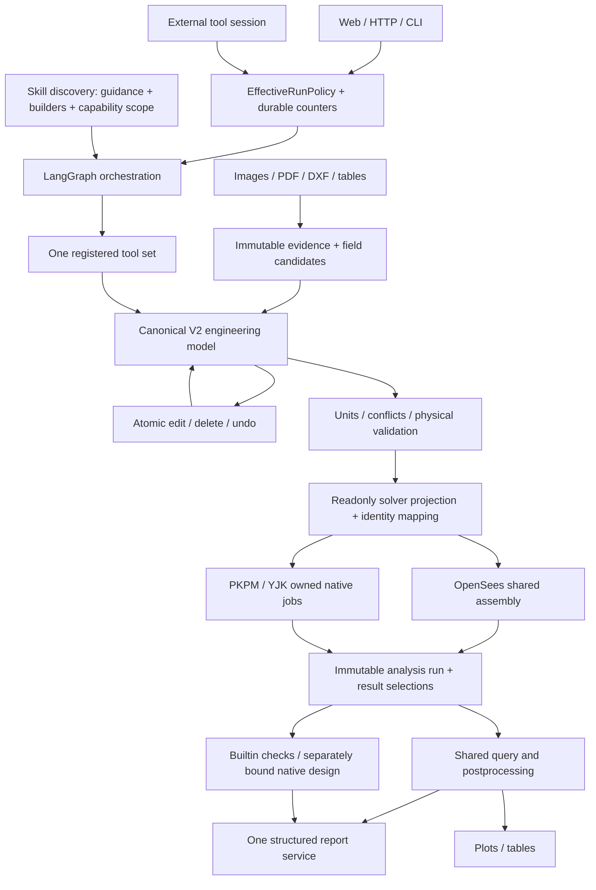

# StructureClaw product runtime / 本体运行链

This guide describes the current product interfaces. The historical preview and paper
tags retain their own manifests; this guide does not change those baselines. Native
capability acceptance is about SDK adaptation, not re-certifying a commercial solver.

本文说明当前本体接口。历史预览版与论文标签按原清单保留。商业验收检查传参、原生执行和结果读回；
不会把测试数量换算成题库覆盖率，也不重新认证成熟商业求解器。

The current snapshot is `engineering-product-preview-20261014`. Its
[acceptance record](reproducibility/engineering-product-preview-20261014.json)
binds the tested code and evidence. This remains a preview: mandatory native adapter
items listed in [the profile audit](native-design-profiles-20261014.md) are still open.

当前快照是本体预览版；验收记录绑定已测试代码及证据。商业适配尚有上述清单中的未完成项，
本快照不是整体方案完成声明，也不是后续实验的300题能力冻结。



Bench is not on this execution path. Optional research commands load their dependencies
only when requested. Production fixtures and numerical references belong to this repository.

Bench 不在生产调用链中。可选研究命令按需加载；本体使用自己拥有的工程夹具和独立参考。

New Web workspaces enable the seven existing structure templates plus generic modeling,
OpenSees static analysis, validation and reporting. Existing saved selections, including
empty selections, are preserved. This does not enable commercial routing or shell access.

新网页工作区默认开放七个现有结构模板，以及通用建模、OpenSees静力、校验和报告。
旧工作区的明确选择（包括空集合）保持不变，不自动增加商业引擎或Shell权限。

## Run control / 运行控制

`backend/src/runtime/run-policy.ts` defines the shared input and effective policy.
Resolution order is defaults → saved session → explicit user update; server permissions
remain the ceiling. A turn freezes its effective policy, fingerprint and counters.
Resume retains them. A new user turn is an explicit operation.

解析顺序为默认值→会话配置→用户明确更新，服务端权限始终是上限。单轮开始后固定策略、指纹和计数，
恢复不会重置。新用户回合需要明确建立。

| Setting / 设置 | Default / 默认 | Meaning / 含义 |
|---|---|---|
| `knowledge` | `enabled` | Optional skill guidance; units/tool protocol/validation remain mandatory / 可选专业说明，不影响单位与硬校验 |
| `builder` | `auto` | Prefer applicable templates; `llm` uses generic modeling / 适用时用模板，可独立切换通用建模 |
| `skillIds` | `null` | All permitted; `[]` means no skills / 全部允许的技能；空数组明确禁用 |
| `routing` | `{mode:"auto"}` | Or fixed allowed modeling skill / 或固定允许的建模技能 |
| `repair` | enabled, 2 | At most two extra semantic corrections per user turn, shared by nested operations / 每回合最多两次额外语义纠错，嵌套调用共享 |
| `context.history` | `full` | `current-turn` removes older conversation text, not engineering history / 只控制对话文本，不删模型历史 |
| `context.memoryScopes` | conversation + workspace | Memory operations still default to conversation; workspace must be explicit / 工具默认会话范围，工作区须显式指定 |
| `tools.enabledIds` | `null` | All permitted defaults; `[]` means no tools / 默认允许范围，空数组无工具 |
| `budgets.maxToolCallsPerTurn` | 200 | Existing server limit remains authoritative / 仍受服务端上限约束 |
| `budgets.maxLlmCallsPerTurn` | `null` | Optional cap on StructureClaw model calls / 可限制本体模型调用 |

Shell remains disabled by default. `repair.enabled=false` gives zero corrections but
does not prevent the first normal build→analyze→query→report chain. Transport retries
retain their existing LLM configuration; native solver submissions are not blindly retried.
Old benchmark environment switches no longer alter production behavior.

Shell 默认关闭。禁用纠错不会阻止首次正常工作流，只阻止失败后的额外语义修正。LLM 传输重试保持既有设置，
求解作业不会因响应丢失而盲目重交。旧评测环境变量不再改变生产行为。

`EffectiveRunPolicy` returns field sources, `policyHash`, actual allowed/denied skills and
tools, and enforcement ownership. LLM calls record usage, duration, failure and owning run.
Model credentials are not policy fields and are not exported in these records.

生效配置返回字段来源、指纹和实际权限。模型调用统一记录用量、耗时、错误与所属运行；密钥不进入公开运行记录。

## Shared entry points / 统一入口

Web advanced run settings send `context.runPolicy` to the same agent endpoint used by
`sclaw run --request request.json`. The CLI honors the configured backend port (default
31415); `--url` overrides the address. Example request:

网页高级设置与 CLI 使用相同的 agent 请求。CLI 沿用后端端口配置，默认31415，可用 `--url` 明确指定。

```json
{
  "message": "Analyze the current model and report the requested results.",
  "context": {
    "runPolicy": {
      "knowledge": "enabled",
      "builder": "auto",
      "repair": {"enabled": false},
      "budgets": {"maxToolCallsPerTurn": 200}
    }
  }
}
```

External hosts import `getPublicToolDefinitions` and `createPublicToolSession` from
`backend/dist/agent-langgraph/public-tool-contracts.js`. Create a session, call
`invoke(toolName,args)`, and use `{sessionId,resume:true}` to resume. The service owns
state, permissions, usage and pending-call records; a saved unknown operation must be
inspected before retry. `{sessionId,newTurn:true}` declares an actual new user turn.

外部宿主使用同一注册表和持久会话；恢复保留权限与计数。未确认完成的操作不得直接重发。
宿主自己的 LLM 循环和对话文本由宿主管理，返回的 enforcement 会明确这一点。
外部会话不接受假装能强制删除宿主上下文的配置。旧低层工具接口不自动获得新会话控制保证。

Persistent sessions claim an atomic file lock across host processes. Competing hosts
are rejected; calls in one host remain queued. An abandoned `.claim` is not taken over
because of elapsed time or a missing PID: inspect the recorded pending operation and
its native job before explicitly recovering it. Only the owning claim can be released.

持久会话使用跨进程原子占用，同进程调用继续排队。异常退出留下的 `.claim` 不按超时或PID消失自动夺取；
必须先核查记录中的未决操作及原生作业，再明确恢复。释放操作只清理自己持有的占用。

## Engineering identity and jobs / 模型身份与作业

The canonical model is the only writable physical source. Analysis projections remove
known design-only inputs but preserve them on the source and native design context.
Unknown physical properties cannot disappear silently. Material `E/G`, section geometry,
loads and units must survive conversion consistently.

唯一可写模型保留物理属性、设计资料及证据。分析只读投影可分离与弹性无关的设计参数，不能删掉物理条件。
单位为 m、kN、kN·m、MPa、kg/m³；截面几何 mm，A/I/J 为 m²/m⁴；动力节点质量使用 tonne。

Graph publication binds `modelRevision + modelHash + settingsHash + requestSequence`.
Edits and undo create new versions; historical results remain readable. HTTP persisted
tasks use an atomic ownership reservation plus model-version/settings checks. An old
completion cannot overwrite a changed task; its run remains archived.

`POST /analyze` accepts a UUID `requestId`. Repeating a completed identical request reads
its archive; reusing an ID with different input fails. `GET /analysis-requests/:requestId`
reads status; `POST /analysis-requests/:requestId/cancel` only cancels a process owned by
this service. Unowned running records after a restart are `outcome_unknown`.

重复请求先查已有作业，不重新启动。取消只能作用于本服务持有的作业。PKPM/YJK 使用私有工作目录和进程归属，
独立 YJK API 的源码、配置与用户任务不属于此流程。

Commercial static cases and eligible linear combinations are views of one native job.
The adapter selects signed results with its verified native mappings; the application
does not recreate vendor combination mechanics or mix component-wise envelopes.

商业多工况/组合来自同一次原生作业。原生自动设计组合单独保存，不冒充用户选中的分析组合。

## Results, native design and reports / 结果、原生设计与报告

`query_results` identifies run, case/combination, object, component, position or end,
units, and optional modal/time index. Static member positions are metres from the
physical start, with explicit breakpoint side. Time-history member forces require
`end:n1|n2`; velocities/accelerations retain the same DOF names and use `m/s`, `rad/s`,
`m/s2`, `rad/s2` (or explicit mm equivalents).

动力记录的位移/速度/加速度为 UniformExcitation 下相对量；反力口径保存在 responseDefinition。
自由度没有可解释响应时返回缺项。模态分量查询使用 `unit:"1"`，按全模型平移分量最大绝对值归一化，
返回缩放依据，不把特征向量当实际米制位移。

`run_code_check` takes `provider:auto|native|builtin`. Auto selects native for PKPM/YJK
and builtin for OpenSees. Native requests specify a supported **actual code edition**,
design mode, required inputs and explicitly adopted native defaults. Changing assumptions
creates a new analysis run before binding design outputs.

所需配筋模式没有验算已有配筋；读回的官方检查存在超限时 `complianceStatus=fail`，
其余完成情况为 `not_evaluated`，不发布已有配筋通过结论。
Required reinforcement does not certify installed bars. Read-back native failures
take precedence (`fail`); otherwise completed required-area design is `not_evaluated`.
官方空数组、哨兵值、未知字段均不能变成零或通过。数值刚度载体不构成真实设计截面。
原生验算结论仅涵盖已经读回的官方检查范围。

`generate_report` and HTTP `POST /tasks/:id/report` share the report service. They use
model snapshots, run identity, selected quantities and design records. Report schema 1.1
retains quantities with position, sign, unit and time/mode source. A PKPM self-formatted
attachment is labeled **native results reformatted by StructureClaw**, not an official
vendor report. Its project path and SHA must still match the bound run.

## Independent verification / 本体验证

Build before standalone scripts. None of these commands needs the Bench checkout or
a paid model call. Solver tests need the configured local Python environment.

```text
npm run build --prefix backend
npm run lint --prefix backend
npm test --prefix backend -- --runInBand
node backend/tests/engineering-http-acceptance.mjs
node backend/tests/engineering-opensees-tool-acceptance.mjs
node backend/tests/engineering-task-lifecycle.mjs
```

Opt-in public native tool checks / 按需执行真实商业公开工具验收：

```text
node backend/tests/engineering-commercial-tool-acceptance.mjs pkpm backend/tests/fixtures/pkpm-public-design-model.json backend/tests/fixtures/pkpm-public-design-request.json
node backend/tests/engineering-commercial-tool-acceptance.mjs yjk backend/src/agent-skills/analysis/yjk-static/__tests__/fixtures/native-design-concrete-model.json backend/tests/fixtures/yjk-public-design-request.json
```

These runs use configured private SDK installations, then verify analysis, native
design, exact queries, both report languages, session resume and missing-input refusal.
Inputs and receipts belong to the product runtime. They make no provider/LLM calls.
The accepted native profiles and remaining adapter gaps are documented in
[native-design-profiles-20261014.md](native-design-profiles-20261014.md).

该入口使用已配置的独立SDK，验证分析、原生设计、查询、双语报告、会话恢复及缺项拒绝，
不调用付费语言模型。可用原生配置及剩余适配缺口见上述文档。

For unattended startup, use `sclaw start --no-open`. The CLI honors
`settings.json.analysis.pythonBin`; health checks use the backend port that serves both
UI and API. A linked `node_modules` cannot be automatically cleared by dependency setup.

无界面启动使用 `sclaw start --no-open`。CLI与服务使用同一Python配置；网页与API使用同一端口。
依赖安装不会自动清空指向其他目录的 `node_modules` 链接。

The task lifecycle script creates its own SQLite database and verifies a real atomic
claim, duplicate refusal, late publication after an edit, archive retention and explicit
rerun. Native SDK acceptance additionally compares a small set of reviewed native
projects with official readback; mocks cannot establish installed SDK behavior.

迁移变化：默认纠错统一为每回合最多2次；新配置中 null 与空集合明确区分；旧字段仅在入口转换，
冲突报错。历史会话仍可读，继续计算时经过统一转换。未通过原生验证的必需能力仍是未完成项，
不能由构建、接口或单元测试通过替代。
