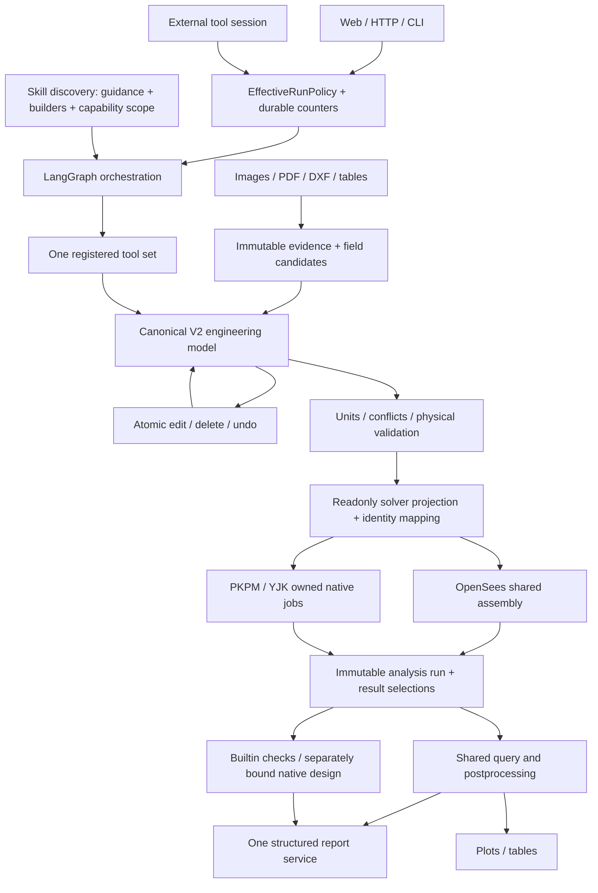

# StructureClaw product runtime / 本体运行链

This guide describes the current product interfaces. The historical preview and paper
tags retain their own manifests; this guide does not change those baselines. Native
capability acceptance is about SDK adaptation, not re-certifying a commercial solver.

本文说明当前本体接口。历史预览版与论文标签按原清单保留。商业验收检查传参、原生执行和结果读回；
不会把测试数量换算成题库覆盖率，也不重新认证成熟商业求解器。

The historical snapshot `engineering-product-preview-20261014` and its
[acceptance record](archive/acceptance-records-2026-10/engineering-product-preview-20261014.json)
bind the code and evidence tested at that time. Later development does not move that
tag or rewrite its failures. The [native profile audit](native-design-profiles-20261014.md)
describes its accepted profiles and the limits observed at that point; it is not a
declaration that every commercial feature is required by the current product scope.

历史预览标签及验收记录保持不变，后续开发不移动标签或改写失败记录。原生配置审计说明当时的验收范围与限制，
不表示其中列出的每项商业高级功能都是当前场景的必需项；也不构成300题逐题通过声明。

The 2026-10-14 convergence priority is faithful expression of the frozen scenario plan,
SDK execution and result readback. The commercial solvers are trusted; tiny numerical
residuals and complex native design outside that plan do not gate scenario compatibility.
Existing preview tags and historical evidence remain unchanged. Code-to-requirement mapping
does not mean that all 300 questions have been run and passed.

2026-10-14收敛优先级是冻结规划所需的准确表达、SDK执行与结果读回。商业求解器本身可信；
微小数值残差与规划外复杂原生设计不作为场景兼容门槛。既有预览标签与历史证据保持不变，
代码与需求的对应关系不代表300题已经逐题运行通过。

The [current entry acceptance](archive/acceptance-records-2026-10/product-entry-closeout-20261014.json)
binds the final source, full backend and frontend integration regressions, and a real
production-only tarball installation. It includes installed OpenSees queries and the
OpenClaw bridge. This record does not create a new experiment freeze.

[本轮入口验收](archive/acceptance-records-2026-10/product-entry-closeout-20261014.json)绑定最终代码、后端全量与网页集成回归，
以及仅安装生产依赖的真实安装包检查，涵盖安装后的OpenSees查询和OpenClaw桥。本记录不新建实验冻结版本。



Bench is not on this execution path. Optional research commands load their dependencies
only when requested. Production fixtures and numerical references belong to this repository.

Bench 不在生产调用链中。可选研究命令按需加载；本体使用自己拥有的工程夹具和独立参考。

New Web workspaces enable the seven existing structure templates plus generic modeling,
OpenSees static analysis, validation and reporting. Existing saved selections, including
empty selections, are preserved. This does not enable commercial routing or shell access.

新网页工作区默认开放七个现有结构模板，以及通用建模、OpenSees静力、校验和报告。
旧工作区的明确选择（包括空集合）保持不变，不自动增加商业引擎或Shell权限。

## Run control / 运行控制

`backend/src/runtime/run-policy.ts` defines the shared input and effective policy.
Resolution order is defaults → saved session → explicit user update; server permissions
remain the ceiling. A turn freezes its effective policy, fingerprint and counters.
Resume retains them. A new user turn is an explicit operation.

解析顺序为默认值→会话配置→用户明确更新，服务端权限始终是上限。单轮开始后固定策略、指纹和计数，
恢复不会重置。新用户回合需要明确建立。

File checkpoints restore pending task writes and clarification interrupts, including
nested graph namespaces. Checkpoints and merged task writes use atomic replacement;
corrupt state fails explicitly rather than silently restarting the conversation.
Historical JSON checkpoints remain readable. A completed, checkpointed tool is not
replayed when a later clarification resumes after a process restart. An external
operation whose completion was never persisted still requires job inspection.

文件检查点会恢复待处理任务写入及澄清中断，并隔离嵌套图的命名空间。检查点及合并后的任务写入采用原子替换，
损坏记录明确报错，不能静默开始新会话。旧JSON检查点保持可读；后续澄清重启恢复时不会重放已持久保存的工具。
外部操作若尚未持久保存完成状态，仍须先核查原生作业，不能据此保证任意外部副作用恰好执行一次。

Large checkpoint and pending-write payloads now use lossless gzip inside the existing
typed serializer. A payload-bound identity in each checkpoint lets history selection
avoid deserializing every previous engineering result. Historical typed base64 and JSON
remain readable; invalid identity or compressed data fails explicitly. A fresh-process
readback of the same seven-case native run retained identical content hashes and reduced
three checkpoint files from 74,509,485 raw serialized bytes to 6,405,854 stored bytes.
This is a storage/restart check, not a new native solver acceptance.

较大的检查点与任务写入采用无损压缩，仍使用原有类型序列化。每份检查点的身份绑定其内容，
选择最新记录时无需反序列化全部历史结果。旧记录仍可读取，身份不符或压缩损坏明确失败。
七工况原生结果经过独立进程重读后内容哈希完全一致；三份检查点由约74.5 MB原始序列化内容
压缩为6.4 MB磁盘文件。此项验证存储与恢复，不重复认证求解器。
见[checkpoint acceptance](archive/acceptance-records-2026-10/engineering-checkpoint-20261014.json)。

| Setting / 设置 | Default / 默认 | Meaning / 含义 |
|---|---|---|
| `knowledge` | `enabled` | Optional skill guidance; units/tool protocol/validation remain mandatory / 可选专业说明，不影响单位与硬校验 |
| `builder` | `auto` | Prefer applicable templates; `llm` uses generic modeling / 适用时用模板，可独立切换通用建模 |
| `skillIds` | `null` | All permitted; `[]` means no skills / 全部允许的技能；空数组明确禁用 |
| `routing` | `{mode:"auto"}` | Or fixed allowed modeling skill / 或固定允许的建模技能 |
| `repair` | enabled, 2 | At most two extra semantic corrections per user turn, shared by nested operations / 每回合最多两次额外语义纠错，嵌套调用共享 |
| `context.history` | `full` | `current-turn` removes older conversation text, not engineering history / 只控制对话文本，不删模型历史 |
| `context.memoryScopes` | conversation + workspace | Memory operations still default to conversation; workspace must be explicit / 工具默认会话范围，工作区须显式指定 |
| `tools.enabledIds` | `null` | All permitted defaults; `[]` means no tools / 默认允许范围，空数组无工具 |
| `budgets.maxToolCallsPerTurn` | 200 | Existing server limit remains authoritative / 仍受服务端上限约束 |
| `budgets.maxLlmCallsPerTurn` | `null` | Optional cap on StructureClaw model calls / 可限制本体模型调用 |

Shell remains disabled by default. `repair.enabled=false` gives zero corrections but
does not prevent the first normal build→analyze→query→report chain. Transport retries
retain their existing LLM configuration; native solver submissions are not blindly retried.
Old benchmark environment switches no longer alter production behavior.

Shell 默认关闭。禁用纠错不会阻止首次正常工作流，只阻止失败后的额外语义修正。LLM 传输重试保持既有设置，
求解作业不会因响应丢失而盲目重交。旧评测环境变量不再改变生产行为。

Missing engineering input is a normal clarification state. The extractor does not
repeat the same evidence to fill omitted properties or spend recovery budget on
missing fields. A user answer may refine a unique existing load's omitted direction;
it does not add a second load. Explicit object IDs, different cases and explicitly
different directions remain distinct. Extraction/transport failures still retain
their own error handling and the configured limits.

缺少工程参数属于正常澄清状态，不对同一份证据重复抽取来补写缺项，也不因此消耗纠错次数。
用户补充方向时，更新唯一匹配的未明确方向荷载，不能额外增加同一荷载；明确对象 ID、不同工况和
明确不同方向仍分别保留。抽取失败和传输失败继续遵守各自的错误处理与配置限制。

`EffectiveRunPolicy` returns field sources, `policyHash`, actual allowed/denied skills and
tools, and enforcement ownership. LLM calls record usage, duration, failure and owning run.
Model credentials are not policy fields and are not exported in these records.

生效配置返回字段来源、指纹和实际权限。模型调用统一记录用量、耗时、错误与所属运行；密钥不进入公开运行记录。

## Shared entry points / 统一入口

`requestScope` records response families, method, independent design/report requests,
and exact scalar outputs (object, position, side, component, unit, saved case key).
It belongs to the request, is saved in run metadata, and is accepted by chat context
and public tool arguments. Ordinary analysis does not request code checking or a
calculation book. A deliberate result-workspace action may still request either.
Requested scalars use the common query service and its permissions/budget. Failed
queries remain delivery deficiencies; solver success alone is not full delivery.

`requestScope`记录响应类别、方法、独立设计/报告需求与标量位置、左右侧、分量、单位、工况键；
它属于请求而非物理模型，保存在运行元数据中，聊天context与公开工具共用。普通分析不自动验算
或生成计算书；结果工作区中的明确点击仍可请求这些交付。指定标量走公共查询及权限/预算；
查询失败保留为交付缺项，求解成功不等于所求结果已全部交付。

The public request-scope contract remains strict. Internal parameter extraction may
return a partial goal patch: missing or empty response lists cannot erase the valid
tool request or accepted goal. Invalid advisory fields are recorded separately from
engineering input errors. With no known response goal, ask for the requested results
while retaining the extracted geometry and loads; do not invent a response list or retry extraction.

公开请求范围仍严格校验。内部参数抽取可以只补充目标字段；缺失或空的响应列表不能清空外层
有效请求或已接受目标。内部辅助字段异常单独记录，不再把它误报成用户工程参数错误。确实没有
可用目标时，保留已抽取的几何与荷载并正常澄清所求结果，不编造响应列表，不重复抽取。

Force-only requests (internal forces, reactions) go through the normal solver. Without a
declared material or section the template builder uses labelled unit stiffness and records
the static indeterminacy; an indeterminate structure is solved with equal EI and the answer
states that assumption. Displacements of such a run are never presented, and a later
displacement, period or design request asks for the real material and section. Runs saved by
the retired equilibrium shortcut (engine `builtin-equilibrium`) still load and display
read-only; the `requestScope.method` field is accepted and ignored.

只求内力或反力的请求走普通求解器。未给材料或截面时，模板以标注的单位刚度建模并记录超静定
次数；超静定结构按各构件EI相同求解，回答中说明该假定。此类运行的位移不展示；之后要求位移、
周期或设计时询问实际材料和截面。旧平衡捷径（引擎`builtin-equilibrium`）保存的运行仍可只读
加载和显示；`requestScope.method`字段被接受但忽略。

For elastic statics with self-weight explicitly disabled, V2 may omit unused rho.
OpenSees retains absent density; self-weight and density-derived mass still require
it. Commercial custom material setters may require density as an SDK condition.
Invalid declared density remains rejected. Concrete analysis uses the shared elastic
template without reinforcement/slab sizing prerequisites. Section records are
associated by an unambiguous ID/name; designations are labels with no catalog lookup, and
only a four-dimension H designation is read as sharp-corner geometry. These are general product behaviors, with no Bench IDs or runtime flags.

自重明确关闭的弹性静力可不提供不用的密度，OpenSees保留缺项而不补假值；自重和密度质量来源
仍要求密度，商业自定义材料可因SDK写入条件而需要它。显式无效密度仍被拒绝。混凝土分析复用
公共弹性模板，不先做钢筋/楼板选型。截面按唯一ID/名称关联；型号只是名称，不查目录，仅四项尺寸的H型号按无圆角几何读取。
这些是通用产品行为，不读取Bench题号或评测开关。

Web advanced run settings and `sclaw run --request request.json` use the shared agent
service and `context.runPolicy` contract. The CLI sends JSON to `POST /api/v1/agent/run`
and honors the configured backend port (default 31415); `--url` overrides the address.
Example request:

网页高级设置与 CLI 使用相同的 agent 请求。CLI 沿用后端端口配置，默认31415，可用 `--url` 明确指定。

```json
{
  "message": "Analyze the current model and report the requested results.",
  "context": {
    "runPolicy": {
      "knowledge": "enabled",
      "builder": "auto",
      "repair": {"enabled": false},
      "budgets": {"maxToolCallsPerTurn": 200}
    }
  }
}
```

The initial `context` also accepts `locale` (`en`/`zh`), uploaded `attachments`
(`fileId`, `originalName`, `relPath`, optional `mimeType`), `restrictFileAccessToAttachments`
and `seismicWorkflow`. Attachments enter the same parsers and evidence transactions as Web.
Upload files to `POST /api/v1/files/upload?conversationId=<id>` first, then use its returned
metadata; a path alone is not a declaration that its contents were reviewed.

初次请求还接收语言、上传附件元数据、附件访问范围和地震工作流配置。附件进入网页同一套解析及证据事务；
先通过上传接口取得元数据，再放入`context.attachments`，不能把一个路径当作已复核内容。

If the JSON response has `waitingForReply: true`, answer its `question`/`options` with
`sclaw run --resume --request reply.json` (HTTP: `POST /api/v1/agent/resume`):

返回`waitingForReply: true`时，用以下文件回复已保存的问题，不重新发起`run`：

```json
{"conversationId":"<returned-conversation-id>","resumeValue":"A is pinned / A为铰支座"}
```

Resume accepts only these two fields. It keeps the original policy, counters, locale and
file access scope. New context/policy overrides are rejected; a conversation that is not
waiting returns HTTP 409. Neither CLI entry retries a lost response or automatically
starts a new turn. `success: true` with `waitingForReply: true` means the turn paused
successfully, not that its engineering work is finished.

恢复仅接收上述两个字段，保留原策略、计数、语言与文件访问范围，拒绝夹带新配置；未等待回复的会话返回409。
CLI不因响应丢失重试，也不自动另起回合。`success: true`且`waitingForReply: true`表示已暂停等待，
不表示工程任务完成。

For a supplemental drawing/table while waiting, register and read it in the existing
input-review transaction before resuming. This PowerShell sequence uses the returned
conversation ID and preserves its policy/tool budget:

等待时补图或补表，先使用同一会话的输入复核事务登记并读取，再回复问题。以下PowerShell步骤沿用原权限和预算：

```powershell
$server = 'http://127.0.0.1:31415'
$conversationId = '<returned-conversation-id>'
$upload = curl.exe -s -F 'file=@support.csv' "$server/api/v1/files/upload?conversationId=$conversationId" | ConvertFrom-Json
$view = Invoke-RestMethod "$server/api/v1/agent/input-review/$conversationId"
$body = @{
  revisionToken = $view.revisionToken
  tool = 'analyze_file'
  args = @{ filePath = $upload.files[0].relPath; mode = 'full' }
  initialContext = @{ attachments = @($upload.files[0]) }
} | ConvertTo-Json -Depth 15
$reviewed = Invoke-RestMethod -Method Post -ContentType 'application/json' -Body $body "$server/api/v1/agent/input-review/$conversationId/tools"
$answer = @{ conversationId = $conversationId; resumeValue = 'Support details are in support.csv / 支座信息见补充表' } | ConvertTo-Json
[System.IO.File]::WriteAllText((Join-Path $PWD 'reply.json'), $answer)
node sclaw run --resume --request reply.json --url $server
```

`analyze_file` must already be allowed by the saved policy. Inspect `$reviewed` before
continuing; reading a file does not confirm conflicting fields or apply them to the model.
Use the same endpoint's `review_input` / `edit_model` / `validate_model` actions as needed,
always with the latest revision token. See the [input-review contract](input-review-contract.md).

原策略必须已允许`analyze_file`。继续前检查`$reviewed`；完整读取不会自动解决字段冲突或修改模型。
按需通过同一接口复核字段、修改模型并校验，每次使用最新版本令牌；上述门禁在恢复后仍然有效。

External hosts import `getPublicToolDefinitions` and `createPublicToolSession` from
`backend/dist/agent-langgraph/public-tool-contracts.js`. Create a session, call
`invoke(toolName,args)`, and use `{sessionId,resume:true}` to resume. The service owns
state, permissions, usage and pending-call records; a saved unknown operation must be
inspected before retry. `{sessionId,newTurn:true}` declares an actual new user turn.

外部宿主使用同一注册表和持久会话；恢复保留权限与计数。未确认完成的操作不得直接重发。
宿主自己的 LLM 循环和对话文本由宿主管理，返回的 enforcement 会明确这一点。
外部会话不接受假装能强制删除宿主上下文的配置。旧低层工具接口不自动获得新会话控制保证。

The optional [OpenClaw plugin](../integrations/openclaw/README.md) is shipped with the
product and uses this same contract. It has no Bench dependency. Host identity selects
the engineering session; an agent cannot reset its budget by declaring another turn.
Subsequent turns use the documented operator entry. The bridge's schema, persistence,
attachment and real host-loading checks are recorded [here](archive/acceptance-records-2026-10/openclaw-product-bridge-20261014.json).

可选[OpenClaw插件](../integrations/openclaw/README_CN.md)随本体打包，复用上述公开契约，不依赖Bench。
宿主身份决定工程会话，智能体不能自行重置预算；后续用户回合由说明中的操作员入口接纳。
真实宿主加载与本体工具测试分别记录，不将两者表述为完整Gateway模型对话已验收。

Persistent sessions claim an atomic file lock across host processes. Competing hosts
are rejected; calls in one host remain queued. An abandoned `.claim` is not taken over
because of elapsed time or a missing PID: inspect the recorded pending operation and
its native job before explicitly recovering it. Only the owning claim can be released.

持久会话使用跨进程原子占用，同进程调用继续排队。异常退出留下的 `.claim` 不按超时或PID消失自动夺取；
必须先核查记录中的未决操作及原生作业，再明确恢复。释放操作只清理自己持有的占用。

`inspectPublicToolSession(sessionId)` returns the current state hash, owner claim,
live persisted usage, and `busy`, `recoverable`, `outcome_unknown`, or `idle`.
When a tool completed but its host stopped before returning, its durable completion
receipt retains the exact output and resulting state. Explicit recovery accepts
`{sessionId, expectedStateHash, expectedClaimToken}` from inspection and publishes
only that recorded completion. It does not invoke the tool, reset usage, change
policy, or take a live owner's session. An idle session also exposes its last
completed output. A later unknown operation cannot reuse an earlier receipt.

外部宿主可先调用 `inspectPublicToolSession`，取得状态指纹、占用信息和实时持久用量。
工具已完成但宿主未返回时，完成记录保留同一次输出及更新后的状态；再将检查得到的
`sessionId/expectedStateHash/expectedClaimToken` 传给 `recoverPublicToolSession`。
恢复只发布已记录的完成结果，不重新调用工具、不重置预算或修改策略，也不夺取仍活跃的会话。
正常空闲会话同样可读最后一次完成输出；较早的成功记录不能替后续未知操作证明完成。

## Engineering identity and jobs / 模型身份与作业

The canonical model is the only writable physical source. Analysis projections remove
known design-only inputs but preserve them on the source and native design context.
Unknown physical properties cannot disappear silently. Material `E/G`, section geometry,
loads and units must survive conversion consistently.

唯一可写模型保留物理属性、设计资料及证据。分析只读投影可分离与弹性无关的设计参数，不能删掉物理条件。
单位为 m、kN、kN·m、MPa、kg/m³；截面几何 mm，A/I/J 为 m²/m⁴；动力节点质量使用 tonne。

Graph publication binds `modelRevision + modelHash + settingsHash + requestSequence`.
Edits and undo create new versions; historical results remain readable. HTTP persisted
tasks use an atomic ownership reservation plus model-version/settings checks. An old
completion cannot overwrite a changed task; its run remains archived.

`POST /analyze` accepts a UUID `requestId`. Repeating a completed identical request reads
its archive; reusing an ID with different input fails. `GET /analysis-requests/:requestId`
reads status; `POST /analysis-requests/:requestId/cancel` only cancels a process owned by
this service. A foreign live owner remains running but is not cancellable here;
records whose owner has stopped are `outcome_unknown`.

Each request now reserves its immutable `runId` before solver submission. If its
owner stopped after writing the run archive but before publishing request completion,
`POST /analysis-requests/:requestId/recover` accepts the inspected `expectedStateHash`.
It verifies the archive's request ID/hash, model/settings and result bindings, then
settles that request without invoking a solver or publishing a current model result.
Missing/corrupt archives, live or unverified owners, and changed requests are refused.
Historical requests without a reserved run identity remain readable but cannot use
this recovery path.

New immutable runs store compact JSON in `run.json.gz`, atomically published after
compression and filesystem sync. `loadAnalysisRun` reads both the new archive and
historical `run.json`, returning the same result structure. Existing run directories
are never overwritten; conflicting or corrupt archives fail explicitly. Compression
does not change numeric precision, result selections, source evidence or model hashes.

新运行以无损压缩JSON归档，完整写入后原子发布。旧JSON运行仍可读取；已有目录不覆盖，
损坏或存在两份冲突归档时明确失败。压缩不改变数值精度、工况、来源和模型指纹。
七工况原生数据的完整归档与重读验证见
[archive acceptance](archive/acceptance-records-2026-10/engineering-native-archive-20261014.json)。

分析提交前保存唯一运行编号。原进程在归档后退出时，可用检查所得状态指纹显式恢复原作业；
归档必须与请求、模型、设置及结果身份一致。恢复不重跑、不将历史结果自动设为当前结果。
缺归档、归档损坏、所属进程仍活跃或身份未知、请求已变化均拒绝；没有预留运行身份的历史请求保持可读。

CLI uses the same endpoints / CLI使用同一接口：

```text
sclaw job status <request-id>
sclaw job recover <request-id> --state-hash <hash-returned-by-status>
sclaw job cancel <request-id>
```

重复请求先查已有作业，不重新启动。取消只能作用于本服务持有的作业。PKPM/YJK 使用私有工作目录和进程归属，
独立 YJK API 的源码、配置与用户任务不属于此流程。

Commercial static cases and eligible linear combinations are views of one native job.
The adapter selects signed results with its verified native mappings; the application
does not recreate vendor combination mechanics or mix component-wise envelopes.

商业多工况/组合来自同一次原生作业。原生自动设计组合单独保存，不冒充用户选中的分析组合。

Self-weight recovery keeps the authored density/area/gravity and the audited native
load separately. YJK's FE file serializes the accepted uniform load with six
significant digits. When that readback is present, equilibrium recovery integrates
the executed value and declares `loadBasis: audited-native-input`; it validates the
source-to-native quantization and every original force station with the existing
force tolerance. It does not alter the source model, original station results or tolerance.

自重恢复分别保存源密度/面积/重力计算值及已审计的原生有效荷载。YJK的FE文件将该均布荷载写为六位有效数字；
取得真实读回后，公共恢复积分实际执行值，标记loadBasis为audited-native-input，同时核对源值量化关系和
全部原生内力站点。源模型、原始站点和已有响应容差均保持不变。

PKPM rigid-span recovery also consumes the saved SDK float, the official text
token and the actual binary load record, bound to the same case/member/input hash.
Only the elastic-span intensity uses that audited executed value; the physical
rigid-arm load integrals keep the authored value. This input audit alone does not
certify arbitrary-position results: every native force station must still close
under the existing tolerance. A failed closure keeps the direct stations and a
structured `memberResponses[].recovery` reason; queries retain the underlying
cause. The current PKPM integration limitation is recorded in
[load-readback verification](archive/acceptance-records-2026-10/engineering-pkpm-load-readback-20261014.json).

PKPM刚域恢复同时核对保存的SDK浮点值、官方文本及实际二进制荷载，绑定同一工况、构件与输入哈希。
净跨使用已审计的执行值，物理刚段荷载仍保留源值积分。这项输入核对不等于任意位置结果已通过；
全部原生站点仍须满足既有容差。闭合失败时保留原生站点，并在构件响应的recovery字段记录具体原因；
查询保留底层错误依据。上述记录明确区分已通过的输入校验与尚未通过的原生交付。

Rigid-end force queries keep the physical member's full length and the native
elastic span separate. Every native station retains its actual position. Extending
forces to a physical endpoint or another cut requires verified rigid lengths and
source-load execution evidence bound to the same native FE input. Recovery checks
all native stations before producing a value; missing evidence leaves only the
verified native stations available. Chart provenance references the actual anchor,
which may be inside the member. This does not provide interior displacement.

刚域内力查询分别保存物理全长与原生净跨。原生站点保持真实位置；恢复到物理端点或任意截面前，
必须核对刚域长度及绑定同一原生输入的荷载执行证据，并通过全部原生站点的平衡检查。
图表来源指向实际使用的净跨站点，不将恢复的物理端点标成原生结果；此能力不提供跨内挠度。
已验证的真实运行及双语交付证据见
[rigid-member delivery](archive/acceptance-records-2026-10/engineering-native-rigid-delivery-20261014.json)。

## Results, native design and reports / 结果、原生设计与报告

`query_results` identifies run, case/combination, object, component, position or end,
units, and optional modal/time index. Static member positions are metres from the
physical start, with explicit breakpoint side. Time-history member forces require
`end:n1|n2`; velocities/accelerations retain the same DOF names and use `m/s`, `rad/s`,
`m/s2`, `rad/s2` (or explicit mm equivalents).

动力记录的位移/速度/加速度为 UniformExcitation 下相对量；反力口径保存在 responseDefinition。
自由度没有可解释响应时返回缺项。模态分量查询使用 `unit:"1"`，按全模型平移分量最大绝对值归一化，
返回缩放依据，不把特征向量当实际米制位移。

`run_code_check` takes `provider:auto|native|builtin`. Auto selects native for PKPM/YJK
and builtin for OpenSees. Native requests specify a supported **actual code edition**,
design mode, required inputs and explicitly adopted native defaults. Changing assumptions
creates a new analysis run before binding design outputs.

A new native-design attempt clears the previous design conclusion and report, while
keeping the last valid analysis available for queries. Missing inputs, unsupported
conditions, failed execution and unknown outcomes do not replace that analysis.
Completed design, including a genuine code-check failure, can publish its own analysis
only while its model, evidence and request identity remain current. Failed attempts
remain in history and never supply conclusions for a different analysis run.

新原生设计请求使旧设计结论与报告失效，但保留此前有效分析供查询。缺资料、未支持条件、执行失败或结果未知
不会替换该分析。完整执行的设计（包括真实验算超限）只有在模型、证据和请求身份仍有效时，才发布其自身分析。
失败尝试保留为历史，不能向其他分析运行提供设计结论。

所需配筋模式没有验算已有配筋；读回的官方检查存在超限时 `complianceStatus=fail`，
其余完成情况为 `not_evaluated`，不发布已有配筋通过结论。
Required reinforcement does not certify installed bars. Read-back native failures
take precedence (`fail`); otherwise completed required-area design is `not_evaluated`.
官方空数组、哨兵值、未知字段均不能变成零或通过。数值刚度载体不构成真实设计截面。
原生验算结论仅涵盖已经读回的官方检查范围。

`generate_report` and HTTP `POST /tasks/:id/report` share the report service. They use
model snapshots, run identity, selected quantities and design records. Report schema 1.1
retains quantities with position, sign, unit and time/mode source. A PKPM self-formatted
attachment is labeled **native results reformatted by StructureClaw**, not an official
vendor report. Its project path and SHA must still match the bound run.

## Independent verification / 本体验证

Build before standalone scripts. None of these commands needs the Bench checkout or
a paid model call. Solver tests need the configured local Python environment.

```text
npm run build --prefix backend
npm run lint --prefix backend
npm test --prefix backend -- --runInBand
node backend/tests/engineering-http-acceptance.mjs
node backend/tests/engineering-opensees-tool-acceptance.mjs
node backend/tests/engineering-task-lifecycle.mjs
```

Completed native rigid-member jobs can be checked without resubmission:
`node backend/tests/engineering-native-rigid-query.mjs <native-acceptance-directory> <new-receipt.json>`.
The directory must contain its source model, independently frozen reference and
successful native acceptance. The command verifies physical-cut values, preserved
native stations, chart provenance and requested quantities in both report languages.
It neither rewrites native artifacts nor substitutes displayed deflection for a result.

已完成的原生刚域算例可用上述命令验证查询、图表和双语报告，不重新提交作业，不改写原始文件。

Opt-in public native tool checks / 按需执行真实商业公开工具验收：

```text
node backend/tests/engineering-commercial-tool-acceptance.mjs pkpm backend/tests/fixtures/pkpm-public-design-model.json backend/tests/fixtures/pkpm-public-design-request.json
node backend/tests/engineering-commercial-tool-acceptance.mjs yjk backend/src/agent-skills/analysis/yjk-static/__tests__/fixtures/native-design-concrete-model.json backend/tests/fixtures/yjk-public-design-request.json
```

These runs use configured private SDK installations, then verify analysis, native
design, exact queries, both report languages, session resume and missing-input refusal.
Inputs and receipts belong to the product runtime. They make no provider/LLM calls.
The accepted native profiles and remaining adapter gaps are documented in
[native-design-profiles-20261014.md](native-design-profiles-20261014.md).

该入口使用已配置的独立SDK，验证分析、原生设计、查询、双语报告、会话恢复及缺项拒绝，
不调用付费语言模型。可用原生配置及剩余适配缺口见上述文档。

For unattended startup, use `sclaw start --no-open`. The CLI honors
`settings.json.analysis.pythonBin`; health checks use the backend port that serves both
UI and API. A linked `node_modules` cannot be automatically cleared by dependency setup.

无界面启动使用 `sclaw start --no-open`。CLI与服务使用同一Python配置；网页与API使用同一端口。
依赖安装不会自动清空指向其他目录的 `node_modules` 链接。

Startup waits up to two minutes for this server instance and its database to become
healthy, reports progress every ten seconds, and stops waiting if the owned process
exits. A cold installation may take longer than a warm start. A timeout is a failure,
not a reason to launch another process automatically.

启动最多等待两分钟，每十秒显示进度，仅在当前服务实例及数据库健康后报告成功；所属进程退出则立即停止等待。
首次安装的冷启动可能慢于后续启动。超时明确失败，不会自动重复启动进程。

Installation migration: lifecycle commands now preserve an explicit SQLite URL;
`doctor` and `start` use the same database. Without explicit configuration, the
canonical runtime database is used; an existing legacy `structureclaw.start.db`
is retained when the canonical file does not yet exist. No history is copied or
overwritten implicitly. Startup does not insert or reset demonstration models.

安装迁移：生命周期命令保留显式SQLite配置，doctor和start使用同一数据库。未配置时使用运行目录中的
标准数据库；若仅有旧版structureclaw.start.db，则继续使用旧文件。不会隐式复制或覆盖历史，也不在启动时
插入或重置演示模型。

Schema changes run in one SQLite transaction, with a readable backup of existing
WAL data. Existing tables, columns and rows must survive; destructive or failing
migrations roll back and fail startup. Package installation uses its compiled
Prisma client. It does not generate TypeScript into the installed package.

数据库变更在单个事务中执行，已有WAL数据先生成可读备份。旧表、字段和记录必须保留，数据损失或迁移失败
会回滚并使启动失败。安装包使用已编译的Prisma客户端，不向安装目录生成TypeScript。

`npm pack` and `npm publish` rebuild both products through `prepack`. An opt-in
tarball check installs into a separate host with production dependencies only,
then checks doctor/start/health/UI, file parsers, skill loading, real OpenSees
queries and stop from an unrelated working directory:

`node backend/tests/engineering-package-acceptance.mjs <package.tgz> <analysis-python>`

此命令验证真实安装包，使用独立配置和临时目录，不调用语言模型；不会发布到npm或修改历史标签。

The task lifecycle script creates its own SQLite database and verifies a real atomic
claim, duplicate refusal, late publication after an edit, archive retention and explicit
rerun. Native SDK acceptance additionally compares a small set of reviewed native
projects with official readback; mocks cannot establish installed SDK behavior.

迁移变化：默认纠错统一为每回合最多2次；新配置中 null 与空集合明确区分；旧字段仅在入口转换，
冲突报错。历史会话仍可读，继续计算时经过统一转换。未通过原生验证的必需能力仍是未完成项，
不能由构建、接口或单元测试通过替代。

Tool boundary handling (2026-10-15): rejected arguments, failed extraction and
uncommitted model candidates preserve the committed model and its current results.
Accepting a draft/model change or reserving a solver request invalidates downstream
artifacts and retains the prior run in history. Solver failures after reservation
do not restore an obsolete result as current.

工具边界处理：参数拒绝、提取失败及尚未提交的建模候选不会清空已确认模型和有效结果；
接受草稿/模型变更或登记新的求解请求时，才使下游结果失效并保存历史。已登记求解请求
随后失败时，不会把旧结果恢复为当前结果。

Nested routing, extraction and generic modeling read provider text blocks through
one text adapter; reasoning/image blocks are not engineering JSON. Optional
clarification choices may be omitted when malformed, while the nonempty question
is still delivered. Input review accepts an empty unused action list, but requires
at least one actual action; empty permission lists retain their existing meaning.

内部路由、参数提取和通用建模统一读取模型的文本块，不把推理或图像块当成工程 JSON。
可选澄清按钮格式错误时仍可提出有效问题。输入复核允许未使用的操作列表为空，但至少
需要一项实际操作；权限空集合的原有含义不变。

Generic and explicit models apply confirmed analysis controls before validation. Density
is not required for elastic analysis with self-weight explicitly disabled; mass
and self-weight requirements remain enforced by the requested analysis.

通用与显式模型先应用已确认的分析控制；明确不计自重的弹性分析不强制要求未使用的密度，
自重与动力质量条件仍按所求分析检查。

A supplied load-field correction clears its previous draft diagnostic only for the matching
load identity, not another load at the same patch-array offset. Unrelated and
newly reported issues remain unresolved.

补充荷载字段后，只清理对应荷载的旧诊断，不按补丁
数组下标误清其他荷载；其他未解决问题和本轮新问题继续保留。

Template role assignments are draft patches: material and section IDs can arrive
separately. Empty optional entries do not erase accepted IDs. Formal building
still requires a resolvable assignment from declared records or declared section
names; ambiguous or unknown references cannot create a model.

模板角色分配允许逐字段补充材料与截面ID，空的可选项不删除已确认ID。正式建模仍须从
已提供的属性记录或截面名称明确确定分配；有歧义或未知引用时不能生成计算模型。
